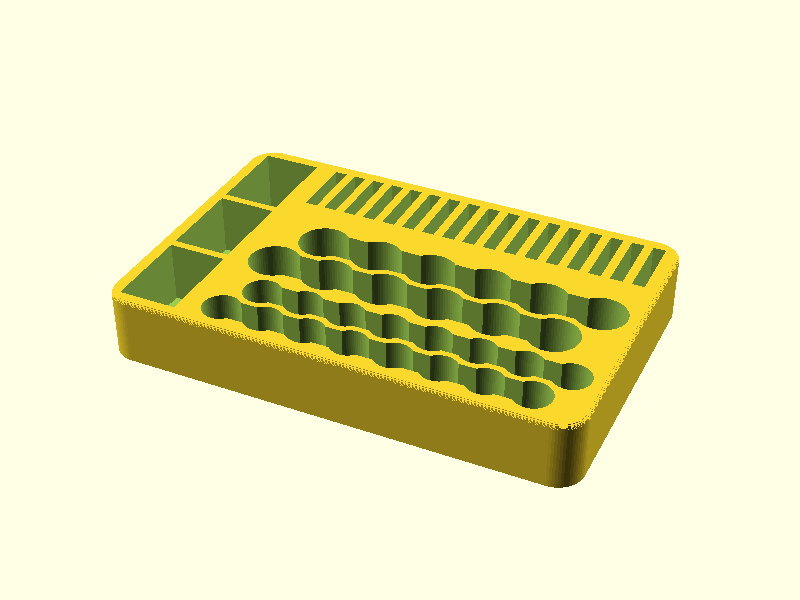

# battery-holder

Desk tray for loose batteries, 141 x 93 x 20 mm with a closed floor: three snug 9V compartments
(17.7 x 26.7 mm, long side front to back) on the left, 17 coin cell slots (CR2032/2025/2016, 20.6 mm long)
along the back, 2 rows of 6 AA and 2 rows of 8 AAA in scalloped trenches. Counts, fit and
height are parameters at the top of [battery-holder.scad](battery-holder.scad).

## Print-speed choices (no change to the look)

* Each AA/AAA row is round holes joined by a slot narrower than the battery. The row is
  one perimeter loop instead of 6-8 small circles, so far fewer retractions and travels.
* Neighbouring rows are offset half a hole and pulled together until the wavy wall
  between them is 4 line widths at its narrowest (two perimeters from each side). It prints
  as perimeters with little or no infill or gap fill, and the tray is shallower. Set
  `line_w` to your slicer's wall line width.

Slicer: no supports, 2 walls, 10-15 % infill, 0.2-0.28 mm layers.
