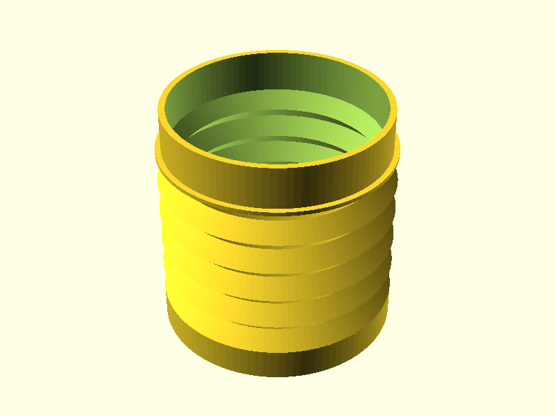
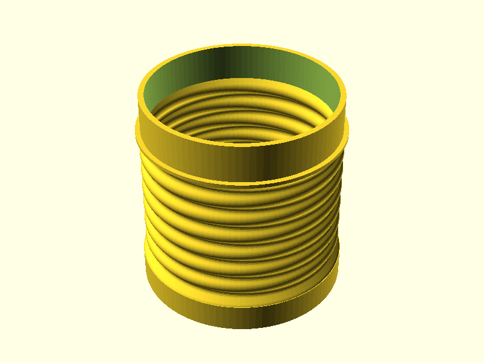
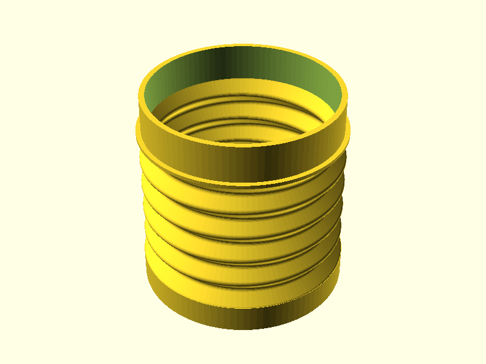
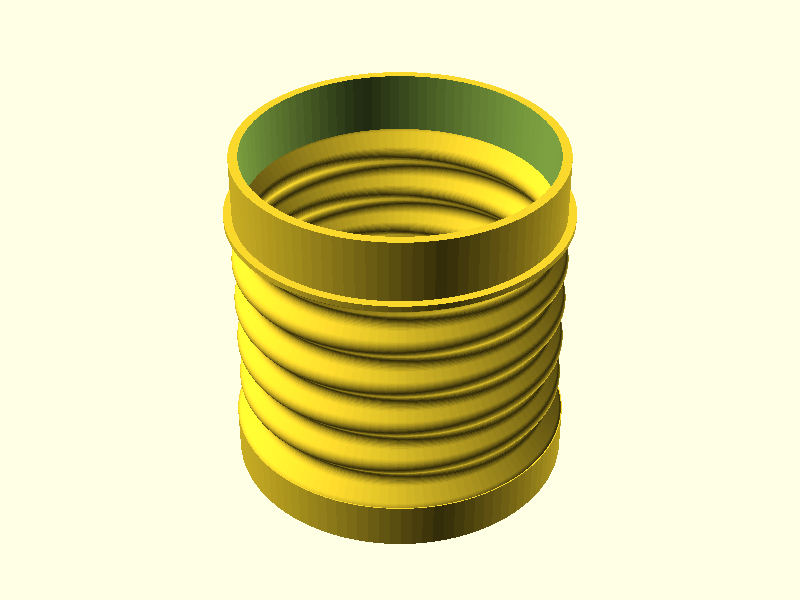
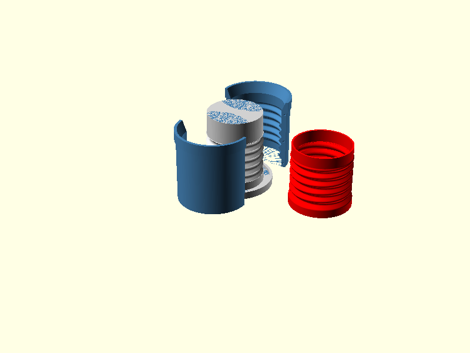
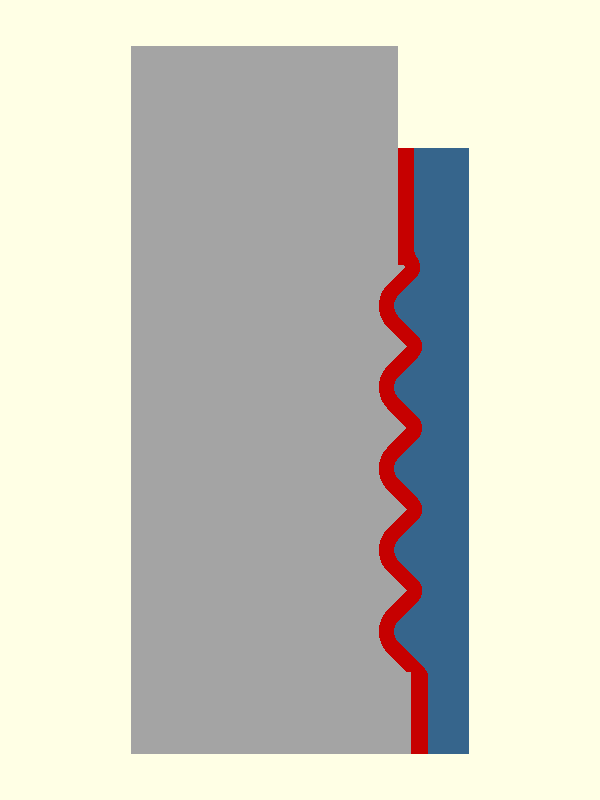

# bellows

## v1: sharp folds ([bellows.scad](bellows.scad))

5 folds of 4 mm, 0.8 mm wall (0.57 mm through the 45 degree slopes), sharp creases. Fits the Zerno Z1 (58.5 mm diameter, funnel cap insert). In TPU it tears at the narrow rings, which is what v2 and v3 try to fix.

## v2: rounded folds ([bellows-v2.scad](bellows-v2.scad))

Same fit as v1 (diameter, cap hole and funnel insert), but with rounded folds, a 0.7 mm wall
measured straight through (v1 is 0.57 mm on its slopes), and 7 shallower folds instead of 5.
Made to stop the tears at the narrow rings when printed in TPU 95A.

## v3: v1 folds, rounded creases ([bellows-v3.scad](bellows-v3.scad))

v2 turned out about 4x stiffer than v1 and barely folds: shallower folds and a thicker wall
(bellows stiffness goes with depth and thickness cubed), and rounding so large there was no
flat wall left to swing. v3 goes back to v1's 5 deep folds with flat walls that swing like
hinges, and v1's wall: every layer is 0.8 mm wide, two 0.4 mm lines, creases included. The
only change is a 1.2 mm radius on every crease instead of a sharp corner, so the stretch
spreads over several layers instead of landing on one layer line. Same fit and roughly the
same stiffness as v1.

Printing tip: a tear that starts at one spot is usually the layer seam. Use a scarf seam if
your slicer has one, and print TPU hot, slow and with little fan so the layers bond well.

## v4: wider creases, one-line wall ([bellows-v4.scad](bellows-v4.scad))

v3 lasted about two weeks, then cracked horizontally about 4 layers above and below the
creases, where its 1.2 mm rounding ends and the flat 45 degree wall starts. The bend had
moved there and was still pulling the layers apart. v4 rounds every crease with 2.0 mm, so
the bend spreads over about twice as many layers. Its wall is one 0.6 mm line instead of
two 0.4 mm lines: a thinner wall stretches less when it bends, and a single line has no
line-to-line bond to peel. Same fit, folds and height as v3. The folds come out a little
shallower, so it should be slightly softer.

Print settings (they matter as much as the shape):
- Line width 0.6 mm with a 0.4 mm nozzle, so each layer is one line (or use vase/spiral mode).
- TPU 95A at about 235-240 C, part fan 0-20 %, 15-20 mm/s. If you can, use 85A TPU,
  which handles repeated bending much better.
- 0.2 mm layers, scarf seam if your slicer has one.

## Silicone casting mold ([bellows-mold.scad](bellows-mold.scad))

Printed TPU keeps cracking along the layer lines, so this mold casts the bellows in silicone,
which has no layers. Same fit as v3: 58.5 mm outside, 5 folds over 40 mm, the funnel cap
socket at the bottom and the funnel insert lip at the top. The silicone wall through the folds is 1.5 mm.
Untested: the first cast is still to do.

Pieces (PLA or PETG, not resin: resin can stop platinum silicone from curing):
- [bellows-mold-core.stl](bellows-mold-core.stl): base plate and inner core, print 1x upright, 0.12 mm layers.
- [bellows-mold-shell.stl](bellows-mold-shell.stl): outer half-shell, print 2x lying on the flat face.

Casting:
1. Sand or smooth the surfaces the silicone touches. Every layer line is copied into the
   part, and a sharp one is where a tear starts.
2. Spray mold release (or wipe on a thin layer of petroleum jelly). Push 1.75 mm filament
   pieces into the pin holes, close the halves around the core inside the plate rim,
   rubber-band them.
3. Silicone needed: about 25 g (mix 35-40 g). Pour in a thin stream down one side of the
   funnel and let it rise up from the bottom. Tap the mold for a minute so bubbles come up.
4. Demold after the full cure. Pull the shell halves apart, then roll the part off the core.
   Trim the funnel ring at the top of the lip.
5. Post-cure about 4 h at 100 C in the oven (or a week at room temperature) before it touches coffee.

Silicone: platinum-cure (addition-cure), Shore 20A-30A, low viscosity, at least 15-20 min
working time. A "5 minute" kit is tight for a narrow 40 mm mold; pour right after mixing.

Half cross-section: core gray, shell blue, cast silicone red.

