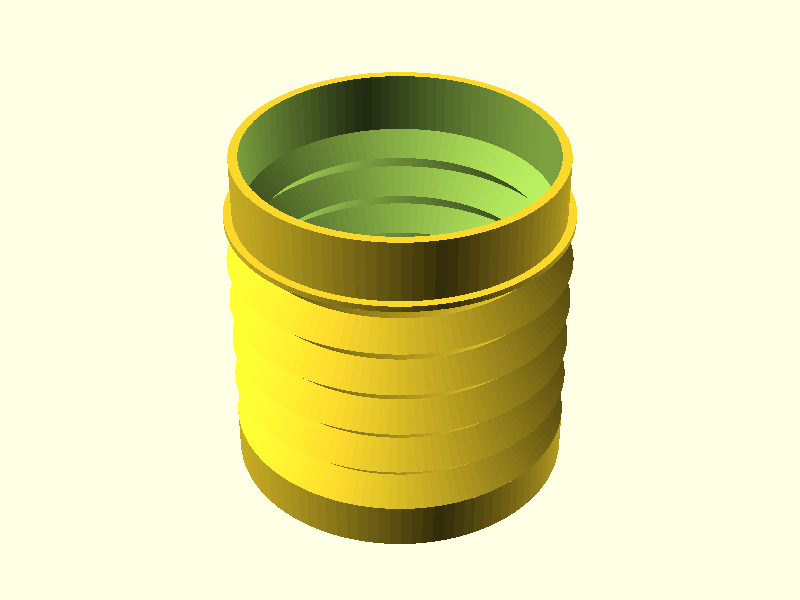
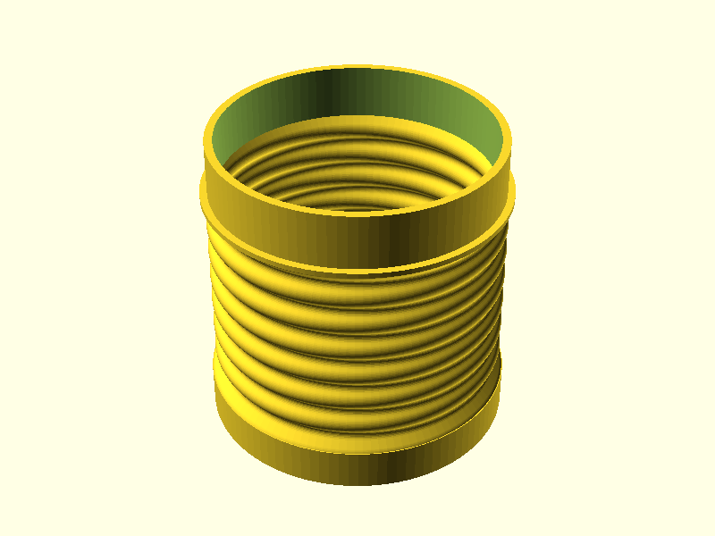
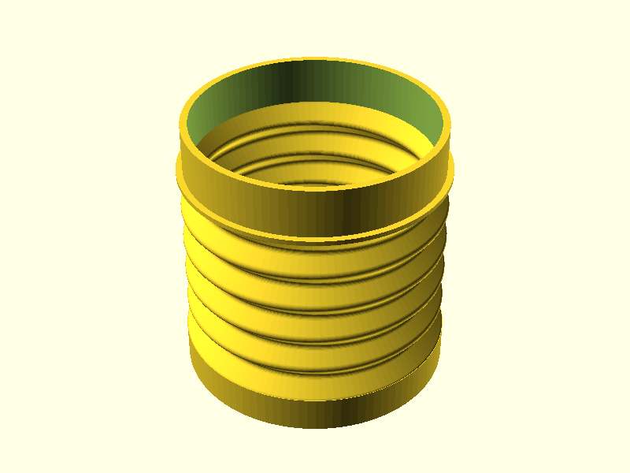

# bellows

## v2: rounded folds ([bellows-v2.scad](bellows-v2.scad))

Same fit as v1 (diameter, cap hole and funnel insert), but with rounded folds, a 0.7 mm wall
measured straight through (v1 is 0.57 mm on its slopes), and 7 shallower folds instead of 5.
Made to stop the tears at the narrow rings when printed in TPU 95A.

## v3: v1 folds, rounded creases ([bellows-v3.scad](bellows-v3.scad))

v2 turned out about 4x stiffer than v1 and barely folds: shallower folds and a thicker wall
(bellows stiffness goes with depth and thickness cubed), and rounding so large there was no
flat wall left to swing. v3 goes back to v1's 5 deep folds with flat walls that swing like
hinges, and v1's wall: every layer is 0.8 mm wide, two 0.4 mm lines, creases included. The
only change is a 1.2 mm radius on every crease instead of a sharp corner, so the stretch
spreads over several layers instead of landing on one layer line. Same fit and roughly the
same stiffness as v1.

Printing tip: a tear that starts at one spot is usually the layer seam. Use a scarf seam if
your slicer has one, and print TPU hot, slow and with little fan so the layers bond well.

