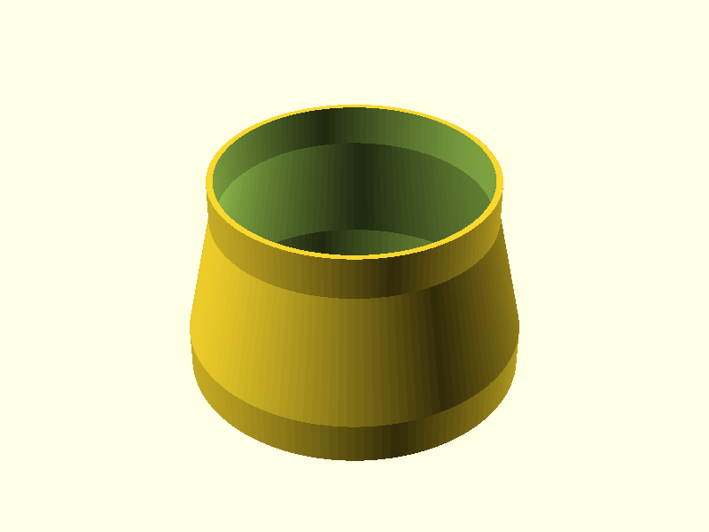
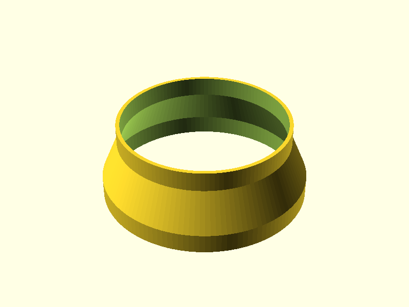
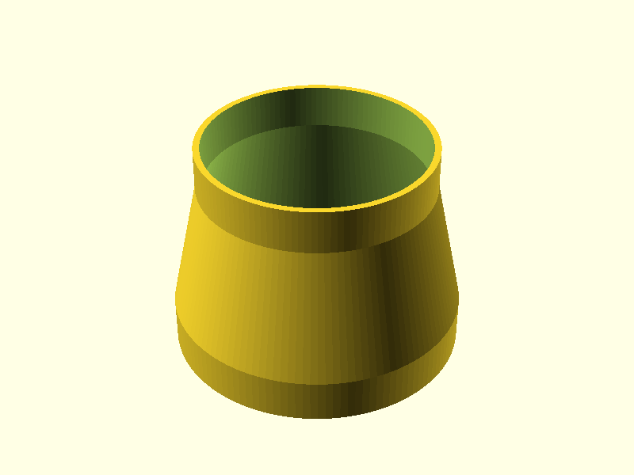

# fan-duct-reducer

Parametric duct reducer / adapter for any two round duct or hose sizes. The ready-made STLs are 6" to 5" with both ends as sockets.

## Standard (100 mm tall)

## Short (60 mm tall)

## 4" to 5" (100 mm tall)

A 4" pipe (outer diameter) slides into the small end and a 5" duct into the large end.

## Custom sizes

Open `fan-duct-reducer.scad` in OpenSCAD and use **Window > Customizer**, or set parameters from the command line:

    openscad -o reducer.stl -D 'units="mm"' -D large_size=125 -D small_size=100 -D 'small_fit="outside"' fan-duct-reducer.scad

| Parameter | Default | Meaning |
|---|---|---|
| `units` | `"inch"` | Units for `large_size` / `small_size`: `"inch"` or `"mm"`. Everything else is mm |
| `large_size`, `small_size` | `6`, `5` | Nominal diameters of the two ducts |
| `large_fit`, `small_fit` | `"inside"` | `"inside"`: the duct slides into the reducer, so use the duct's outer diameter. `"outside"`: a hose slides over the reducer, so use the hose's inner diameter |
| `clearance` | `0.5` | Diametral slip-fit clearance, mm |
| `wall` | `3` | Wall thickness, mm |
| `taper_height` | `60` | Length of the tapered section, mm |
| `lip_length` | `20` | Length of the straight collar on each end, mm |

The render log prints the resulting diameters, total height and taper angle. It warns if the taper is steeper than 45° from vertical. Print with the large end down.

For another preset, make a small file next to it, like `fan-duct-reducer-short.scad`:

    use <fan-duct-reducer.scad>
    duct_reducer(large_size = 4, small_size = 3, small_fit = "outside");
