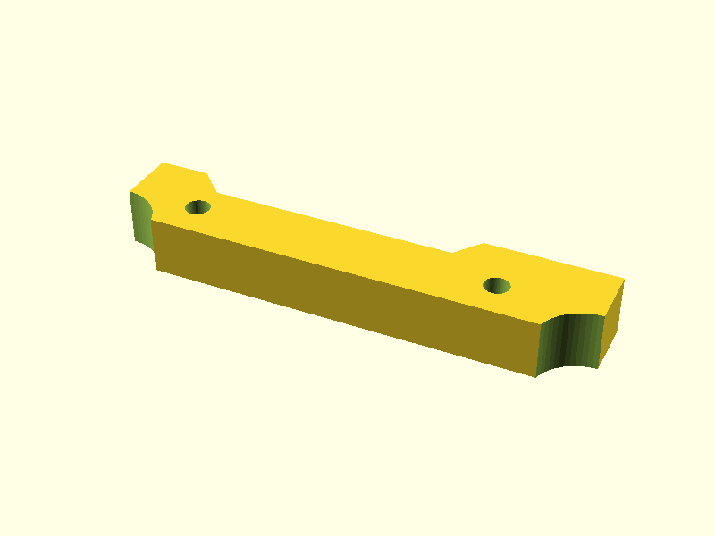

# mounting-bracket

Small bracket, 70 x 14 x 8.5 mm, with two 3.6 mm screw holes and a 14 mm round relief cut at each end. Dimensions are parameters at the top of [mounting-bracket.scad](mounting-bracket.scad).
