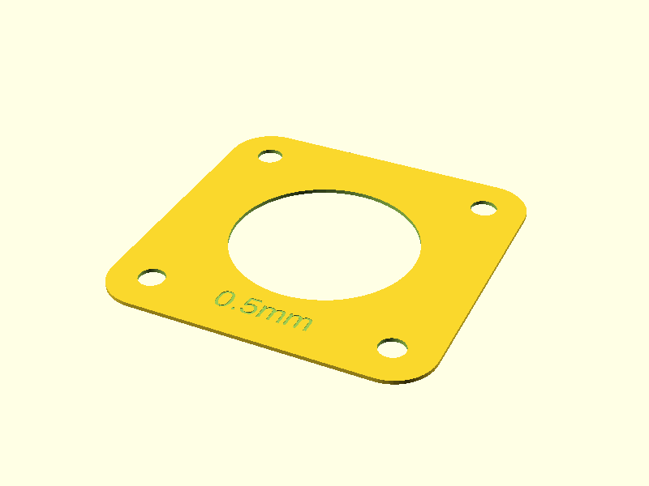

# nema-spacer

Thin flat gasket for a NEMA 17 stepper (31 mm bolt pattern): 4 bolt holes of 3.4 mm, a 24 mm centre hole, corners rounded 5.5 mm. The height (`height`, 0.5 mm by default) is engraved 0.1 mm deep on the face, so you can tell stacked spacers apart.

Fork of [Thingiverse 713203](https://www.thingiverse.com/thing:713203) by VincentM, licensed CC BY-SA (see the header of [nema-spacer.scad](nema-spacer.scad)).
