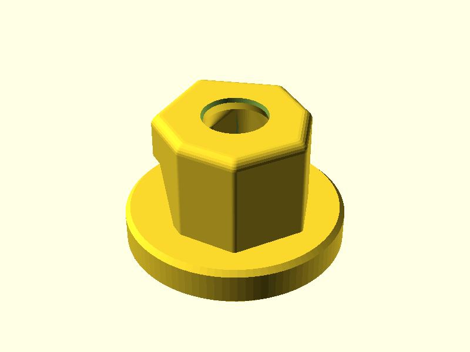

# Shower handle adapter

Printable replacement for the small plastic or brass adapter between a shower or tub valve cartridge stem and the handle. It has a round flange on the valve side and a 7-cornered boss that the handle's socket slides over. An elongated socket with rounded ends underneath takes the stem.



> **Status: mostly measured (2026-11-11).** Boss outline, flange, overall height, window depth and span, stem and the worn stem bore come from calipers on the original. The stem bar's length and the slot depth are still estimated; measure them (checklist below) before the final print.

## Reference photos

| File | What it shows |
|---|---|
| `DTSHA_web.jpg` | White catalog part, three-quarter view. Flat hex top, with a small one-sided window on a hex corner just above the flange |
| `5_1__03938.webp` | Brass version. Left: round bore in the top. Right: elongated socket with rounded ends and a bevelled entry in the bottom |
| `need-help-locating-...webp` | Yellow original next to the handle. Its window is much larger than on the white part |

## Shape

Bottom to top:
- **Flange** with a **stem slot** from below: the cartridge stem is a flat bar 6.44 thick with rounded ends and a screw insert in its middle. The slot grips it tight in the lip (the original wore round here, which is why this part is being redrawn), its long axis square to the upper-right face. Above the lip the boss is a 2.5 shell (2.0 where the bar's ends touch it), hollow up to 11.7, since the bar stands 11.58 out of the bonnet. Bevelled entry. The reference parts in this folder have a different (6-cornered) shape, so none of their sizes are used.
- **Boss**: a symmetric 7-cornered outline (see **Boss outline**), corners rounded 0.6, top edge rounded 1.0 where it goes into the handle. **Round bore** from the top, down to the window ceiling.
- **Window:** one side only, from 0.35 along the upper-right face, over the point, to 0.75 down the left side wall; each side wall of the window is square to its face. Its floor is the flange top and it opens straight into the stem slot (its back wall is on the axis), with no wall left between them.

## Boss outline

A symmetric 7-cornered outline, point up, in the shape of the hand drawing (walls 6.0, closing slightly toward the flat bottom). The face lengths are solved so the part reads the caliper widths taken on the original; the drawing came from a warped photo and gave a part about 1 mm too small. The bore sits at the outline's area centre. Corners are rounded 0.6, so a caliper laid along a face reads its straight part, about 0.7 short of the corner-to-corner size.

| Edge | Corner to corner | Parameter | Drawn | Straight part on the print |
|---|---|---|---|---|
| Each upper face, point to wall top | 8.79 | `boss_top_side` | 8.5 | 8.05 |
| Each side wall | 6.0 | `boss_wall` | 6.0 | 5.50 |
| Each lower face | 5.93 | `boss_low_side` | 5.0 | 5.43 |
| Bottom flat | 7.37 | `boss_bottom` | 8.0 | 6.75 |
| Across the walls, top / bottom ends | 14.38 / 14.18 | `boss_width_top`, `boss_width_bottom` | 14.2 / 14.0 | |

| Caliper reading on the original | Measured | Print |
|---|---|---|
| Across the upper faces and across the lower faces | 15.04 to 15.10 | 15.06 |
| Across the walls | 14.38 | 14.37 |
| Point to bottom flat | 15.85 | 15.78 |

The original is worn, so it reads small; `hex_fit` is 0 (no slide-in allowance). Print `hex_gauge` first: if it is loose in the handle, raise `hex_fit` to 0.1 or 0.2.

## Measurement checklist

Calipers are best. Write down each number and put it into the matching parameter at the top of `shower-handle-adapter.scad`.

| # | Measure | Parameter | Estimate now |
|---|---|---|---|
| 1 | Flange outside diameter | `flange_d` | **22.0 measured** |
| 2 | Flange (lip) thickness | `flange_h` | **3.9 measured** |
| 3 | Boss outline, corner to corner (see **Boss outline**). Corner rounding; top-edge rounding | `boss_top_side`, `boss_wall`, `boss_low_side`, `boss_bottom`, `boss_width_top`, `boss_width_bottom`, `boss_corner_r`, `boss_top_round` | **8.79, 6.0, 5.93, 7.37, 14.38, 14.18 from calipers**, 0.6, **1.0 measured** |
| 4 | Overall height, flange bottom to boss top | `total_h` | **14.0 measured** |
| 4a | Boss width at the flange vs at the top. The original looks skewed on purpose, to wedge into the handle | `hex_taper` | 0 |
| 5 | Window height, from the lip top | `window_h` | **5.7 measured** |
| 6 | Window span: start along the face past the point, end down the side flat; depth = back wall to the far side (caliper jaw inside the window) | `window_start_frac`, `window_end_frac`, `window_back` | **0.35, 0.75 drawn**, -1 (open into the slot; the 11.09 reading came from the worn part) |
| 7 | **Stem bar** (not the worn hole): length end to end, and thickness | `bottom_long`, `bottom_short`, `hole_fit` | 10.0 (estimate: the worn hole is ~10 round), **6.44 measured**, +0.1 |
| 8 | Slot depth: how far the bar reaches into the part. 11.58 measured from the bonnet face, if the lip sits on it | `bottom_depth`, `bottom_shape` | 11.7, obround |
| 9 | Slot angle: the bar's long axis is square to the upper-right face (point to right wall) | `bottom_rot` | **0 (marked on a render)** |
| 9a | Boss wall thickness: above the lip the boss is a shell; the stem slot carries on through it, so the bar sits snug and the window screw presses it against the far wall | `boss_shell` | 2.5 |
| 10 | Bevel size at the socket entry | `bottom_entry_chamfer` | 0.8 |
| 11 | Top bore: takes the stem tip, so it must be tight. Stem 6.44; worn original bore 6.54 x 6.80 (worn oval) | `top_round_d`, `top_round_fit`, `top_round_h` | **6.44 + 0.1 measured**, auto |
| 12 | Stem length out of the cartridge, as a cross-check | (check) | 11.58 measured |
| 13 | Anything not drawn here | (tell me) | |

Helpful photos: one straight at the window, one straight at the side opposite it, one straight down on top, one straight up from the bottom, and one into the handle's socket. A ruler in each shot helps.

The render prints a summary to check before slicing:

    ECHO: "Adapter: flange 22 x 3.9, boss 7 corners, r 0.6, top round 1, taper 0, height 10.1, total 14, stem bore 6.54, window 118 deg wide x 5.7, back wall 0 from centre"

## Fit tests before the full part

Set `part` in the Customizer, or on the command line:

- `hex_gauge`: the top 4 mm of the boss, with the stem bore. It should slide into the handle with no wobble (adjust `hex_fit`) and grip the stem tip with no play (adjust `top_round_fit`; the original wore loose here)
- `bottom_gauge`: the flange only, with the bottom socket. It should push onto the stem snugly. Adjust `hole_fit` (or `bottom_long` / `bottom_short`)

```
openscad -o hex-gauge.stl -D 'part="hex_gauge"' shower-handle-adapter.scad
```

## Printing

Built to print lip down with no supports, from simple convex cuts. Both window side edges lean in by 25 degrees as they rise (`window_taper`), so the window is narrower at the top. Inside, one hollow wraps the stem slot and the shell, its roof leans in at 45 degrees onto the slot (`hollow_dome`), and the slot's rounded ends lean in at 45 degrees to the screw hole. The one flat ceiling left is the strip over the window, a bridge about 10 long. The cap around the top of the screw hole is thin (0.5 at the hole edge) because the dome rises to meet it.

Print flange down with no supports, because the window ceiling bridges. The original is molded plastic, so PETG or ABS/ASA at 100 % infill is a good match. PLA creeps when warm and wet. Only the small ledge inside, where the round bore meets the bottom socket, is unsupported.
