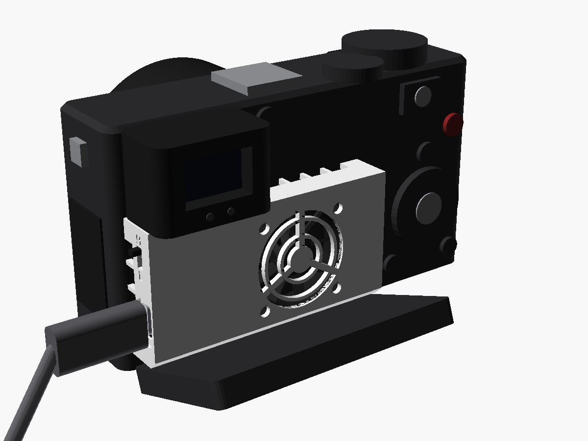
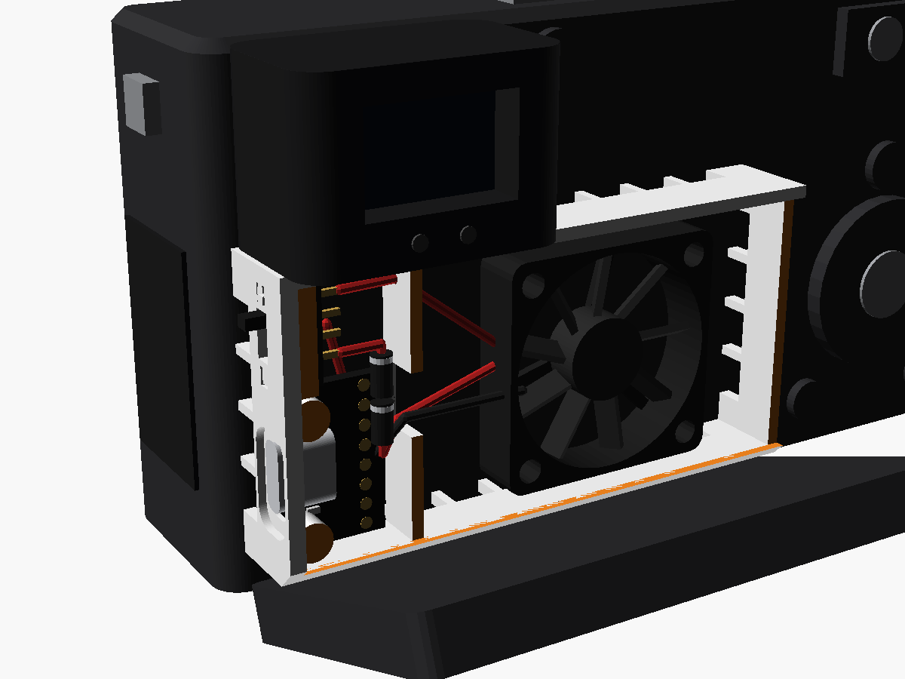
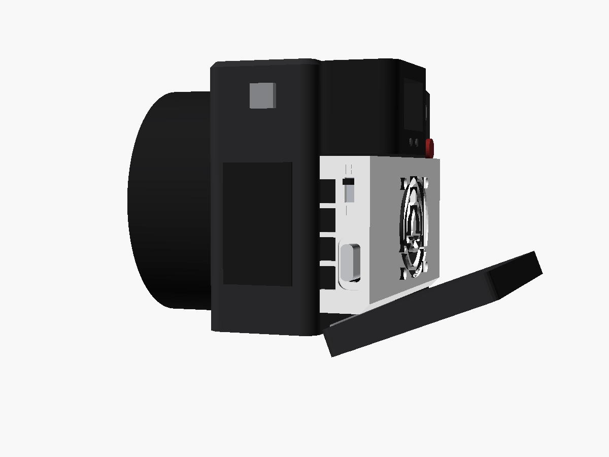
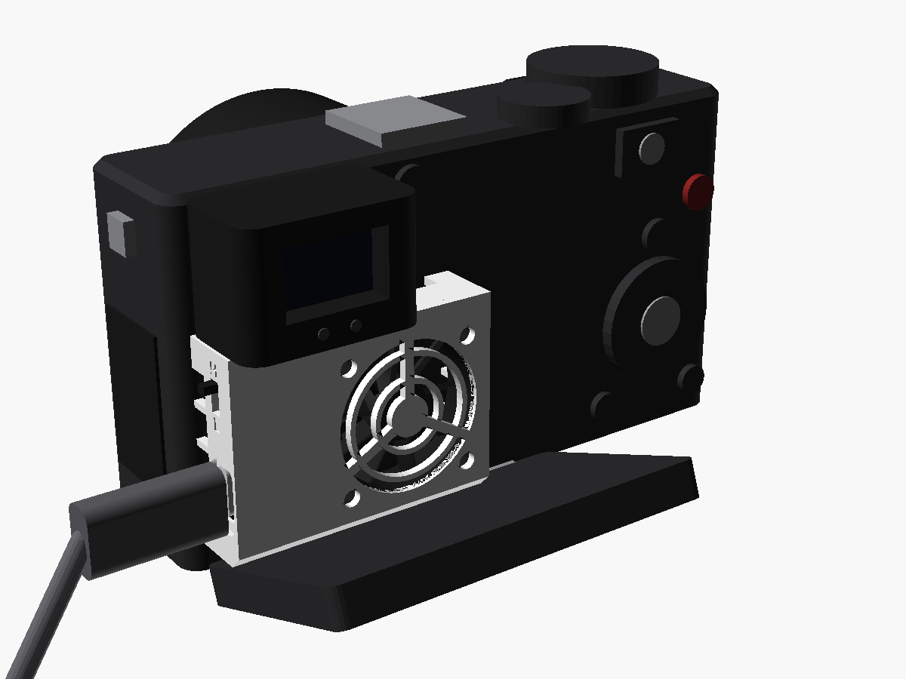

# Sony a6300 rear cooling fan (DRAFT)

A small box that sits on the camera's back plate under the eyecup, behind the tilted-out LCD, and blows
air onto the plate for long 4K takes. It runs from USB-C on the cable side and has a thumbnail slide switch: High / Off / Low.
**It is not measured on the camera yet.** The bought parts are drawn at their real sizes, but the
camera model and the clear space behind the screen are estimates.

| On the camera (74 mm wide, covers the pocket) | Inside (front cut away) | Side: the screen clears the box at ≥ 66° | Narrow version, only as wide as the fan |
|---|---|---|---|
|  |  |  |  |

| File | What |
|---|---|
| [sony-a6300-fan.scad](sony-a6300-fan.scad) | The printable box ([preview](sony-a6300-fan.png)). Parameters at the top |
| [sony-a6300-fan-scene.scad](sony-a6300-fan-scene.scad) | Display only: the box on the camera with the fan, slide switch, diodes, USB-C board, wires and cable. `-D fan=40`, `-D cutaway=true`, `-D lcd_tilt=..` |
| [a6300-camera.scad](a6300-camera.scad) | Display model of the a6300, built from Sony's dimensions. No free a6300 CAD model was found (GrabCAD has an a6000 behind a login) |

## Parts

| Part | Exact item | Size used in the model | Notes |
|---|---|---|---|
| Fan | **WINSINN 3007 5V, hydraulic bearing**, XH2.54 plug, 300 mm leads (Amazon) | 30 × 30 × 7, holes on 24 × 24, M3 self-tapping | 8500 rpm. Hydraulic bearings are quieter than ball bearings and fine with the axis horizontal. WINSINN publishes no airflow or noise figure. The Sofasco table below suggests ~28 dBA at full speed, so plan on quiet mode |
| Fan, ball-bearing alternative | GDSTIME 3007 5V dual ball (Amazon) | 30 × 30 × 7 | 9000 rpm, 4.1 CFM, "25 dBA ±10 %", 0.15 A. Longest life, but more bearing tick and hum |
| Fan, best (if you find it) | Sunon MF30060V2-1000U-A99 | 30 × 30 × 6.5, fits the same box | 3.7 CFM at 15.7 dB(A). Distributors only (DigiKey, Mouser), often out of stock |
| Fan, old option | Noctua NF-A4x10 5V | 40 × 40 × 10 | 4.8 CFM, 17.9 dB(A). Needs the screen fully flat (`-D fan=40`) |
| USB-C | **Adafruit 4090**, "USB Type C Breakout Board – Downstream Connection" | PCB 20.32 × 13.97 × 1.6, connector centred on the long edge, 2 × Ø2.5 holes 15.24 apart, 2.54 in from the connector edge | Numbers from Adafruit's Eagle board file. 5.1 kΩ on CC1 and CC2 (R1, R2), so C-to-C chargers give 5 V. Solder the wires to VBUS/GND, no header |
| Switch | **SS13D07 mini slide switch, 1P3T** (3 positions, "L4" = 4 mm knob), e.g. XKB SS13D07L4B | Body 12.7 × 4.5 × 4.7, knob 4 mm, 2 mm per step | Sits in a printed cradle inside the left wall, the knob pokes ~2.4 mm out through a slot. Thumbnail-operated. H and L engraved beside the slot |
| Low-speed diodes | 2 × 1N4001 (or 1N4007) | DO-41, 5 × 2.7 mm | ~0.8 V drop each, nearly independent of current, so the fan still starts on Low |
| Fixing | 2 printed pins through the board holes (heat-staked), or M2.5 screws into the posts | | |

## Bill of materials

Prices are rough Amazon / Adafruit figures in USD. Check the listings.

| Qty | Item | Exact part / spec | Approx. |
|---|---|---|---|
| 1 | Fan | WINSINN 3007 5V **hydraulic**, XH2.54 plug, 300 mm leads (usually a 2-pack, so one spare) | $10 / 2 |
| 1 | USB-C socket board | Adafruit 4090 USB Type C Breakout – Downstream Connection | $3 |
| 1 | Switch | SS13D07 slide switch, 1P3T, 4 mm knob (Amazon packs are often labelled "SS13D07 3 position") | $6 / 20 |
| 2 | Diodes (Low speed) | 1N4001 or 1N4007, DO-41 | $5 / 100 |
| 4 | Fan screws | M3 × 8 self-tapping (front face 1.6 + fan frame 7) | from a kit |
| 2 | Board screws (optional) | M2.5 × 6, if you don't heat-stake the printed pins | from a kit |
| ~30 cm | Wire | 26 AWG silicone, red + black | $8 / spool set |
| a few | Heat-shrink | 2–3 mm | from a kit |
| 4 | Pads | small self-adhesive rubber or felt, or printed TPU, under the four corner feet | $5 / sheet |
| ~15 g | Filament | PETG or ASA | – |
| 1 | Cable | USB-C to USB-C, **right-angle** plug (keeps the cable tight to the side) | $10 |
| 1 | Power | Any USB-C charger or power bank (5 V, 0.2 A is plenty) | have |
| – | Mount | Not designed yet: cage screw (1/4"-20) or side clamp | – |

Tools: soldering iron, calipers, M3 tap or screwdriver.

## The box

    left wall (cable side)        front (operator side)
      ┌──────┬───────────┐
   ▯──┤ bay  │  ( fan )  │   slide switch above, USB-C below, both out of the left wall
   ▭──┤      │   grille  │   fan blows onto the back plate
       \_____┴───────────┘   bottom-front edge slanted 2.5 mm for the screen
   back edge of all 4 walls: ribbed exhaust band, as tall as the fan-to-plate gap

| | 30 mm 3007 (chosen) | Noctua 40 mm |
|---|---|---|
| Box W × H × D | **74** × 38.0 × **12.6** mm (spans the LCD pocket) | 60.9 × 43.8 × 15.6 mm |
| Exhaust area vs fan free area | 603 / 503 mm², more exit than fan | 603 / 933 mm² |
| Screen tilt needed to clear it (estimated hinge) | **≥ 66°** | 90°, fully flat |

- **Depth:** 1.6 mm front + 7 mm fan + 4 mm gap to the plate = 12.6 mm.
- **Width:** 74 mm, the LCD's width, so the box covers the whole pocket (`box_w_min`, 0 = only as wide as the fan needs).
  The fan sits centred right of the bay, and the rest is a closed chamber: the air has to run along the plate to
  the ribs at the far edges, so it cools the whole covered area, and the longer perimeter adds exhaust ribs.
- **Height:** under the eyecup there are about 44 mm down to the base of the camera. The box height is set by the bay,
  not the fan: the USB-C board (20.3 mm) stacked under the switch (12.7 mm) makes it 38 mm tall.
- **Noise is mostly speed.** Sofasco's datasheet for its 3007 family (same size, sleeve bearing) shows it clearly:
  12000 rpm 35 dBA, 10000 rpm 31, 8000 rpm 26, 6000 rpm 22 (1.6 CFM). The bearing type adds tick or hum on top of that.
  So a hydraulic bearing plus a lower speed is the quiet combination.
- **Two speeds:** the switch is High (up) / Off (middle) / Low (down). Low feeds the fan through two diodes, about 3.4 V, roughly
  5500 rpm and ~21 dBA by the table above. This covers whatever fan Amazon delivers: if it's loud, record on Low.
  If it won't start on Low, use one diode (~4.2 V) or a Schottky 1N5819 pair (~4.2 V, 0.4 V each).
  Diodes beat a resistor here: a resistor drops more voltage when the fan pulls its higher starting current.
  Mount the fan with the label side (the outlet) toward the camera.
- **Airflow:** blowing onto the plate cools better than sucking air off it. The air spreads along the plate
  and leaves at the perimeter, so the exits are a band along the back edge of every wall, with solid
  corners as feet. Higher openings are useless because the fan frame blocks them. Warm air leaves up under the eyecup, down over
  the screen back, to the right toward the buttons, and left through the bay. None of it goes back into the intake.
- **USB-C:** the board stands parallel to the front face on two posts from the front wall. Outside, the left wall is
  counterbored down to 0.6 mm around the opening so the plug's overmold sits in it and the plug reaches full depth.
- **Switch:** slides vertically in the left wall, above the USB-C. The knob sticks out ~2.4 mm; the switch body sits in a printed cradle capped by the top wall.
- **Eye sensor:** it sits under the eyecup, right above the box. Set *FINDER/MONITOR → Monitor (manual)*.
- **Mounting:** not drawn yet. Use a cage rail or 1/4" hole if you have a cage. Otherwise a clamp on the body's
  sides, with TPU pads against vibration.
- **Material:** PETG or ASA, not PLA.

## Wiring

    USB-C VBUS ── switch common
                  switch H  ─────────────────────── fan red (+)   High, 5 V
                  switch L  ──|>|──|>|── fan red (+)              Low, ~3.4 V  (2 × 1N4001, band toward the fan)
    USB-C GND  ─────────────────────────── fan black (−)
    CC1, CC2   ── 5.1 kΩ ── GND   (already on the Adafruit board)

## Facts gathered

| Item | Value | Source |
|---|---|---|
| a6300 body (W×H×D) | 120.0 × 66.9 × 48.8 mm (grip to monitor), 404 g | Sony spec / apotelyt |
| LCD | 3.0" 16:9, tilts ~90° up, ~45° down | apotelyt |
| Sony 4K limit | ~29 min at 20–30 °C, ~20 min at 40 °C, with *Auto Pwr OFF Temp = High* | Sony help guide ILCE-6300 |
| What helps (reported) | LCD pulled away from body, metal cage + thermal pads, external power | DPReview, 4kshooters, diyphotography |
| 30-min cap | Removed by OpenMemories: Tweak (PMCA app, at your own risk) | github ma1co/OpenMemories-Tweak |
| USB power | Micro-USB runs the camera with a battery inside, but Sony warns it adds heat. An NP-FW50 dummy battery on 5 V/2–3 A moves the battery heat outside | Sony help guide, dummy-battery listings |

## Copper (idea, later)

The fan comes first. Afterwards, small stick-on finned heatsinks (≤ 3 mm tall with a 4 mm gap) or flat copper
on **thermal tape** under the fan may add a little. Plain double-sided tape insulates.

## Measure on the camera (calipers, screen at your shooting angle)

1. Clear **height** from under the eyecup down to the camera base, and where the LCD hinge sits (height, distance from the back plate).
2. Clear **width** from the left body edge (or cage) to the first button on the right.
3. Eyecup protrusion from the back plate.
4. The screen angle you shoot at.
5. Cage, if any, and where its threaded holes are.

## Steps

1. Measure, then fix `a6300-camera.scad` (eyecup, LCD hinge) and check the scene's tilt echo.
2. Check the screen clears the box at your shooting angle (the scene's echo).
3. Order the parts above, plus a short C-to-C cable.
4. Add the mount, print a fit test, and only then export the STL.
5. Test with 4K, Auto Pwr OFF Temp = High, the 30-min cap removed, and a dummy battery. Log the time to the
   overheat warning with and without the fan, at the same room temperature.
