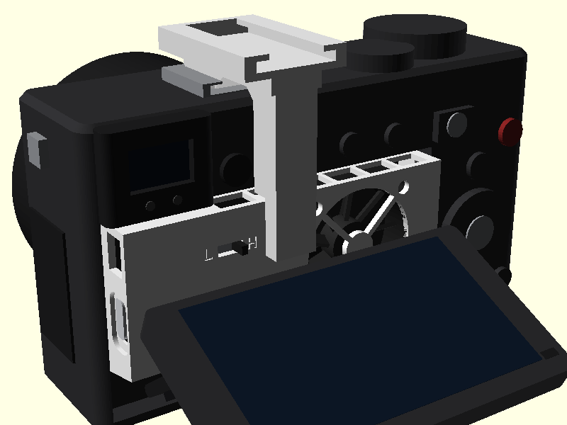

# Sony a6300 rear cooling fan (DRAFT)

A small box that sits in the screen recess on the camera's back, under the eyepiece, with the screen
tilted out, and blows air onto the magnesium back plate for long 4K takes. It runs from USB-C on the
cable side and has a thumbnail slide switch: Low / Off / High. A second part, a tool-free shoe arm,
slides into the flash shoe after the box is seated and locks it in place with zero screws or inserts.
The box size comes from a cardboard test on the real camera; the shoe and button positions from caliper
readings and photos (±2 mm). **Not printed yet.**

The camera's dual-hinge screen linkage, solid lower tilt arm, left-center flex-ribbon shelf, and `2026-11-19` top ruler positions are modelled and checked in the scene; the exhaust outlets sit outside the 5.2 mm recess and avoid the eyecup, fan housing, and flex-ribbon shelf (`313 mm²` unblocked free-air exhaust on right/top/left with `arm_mount = true`, `337 mm²` standalone, plus `181 mm²` secondary right-side bottom-back bleed vs `503 mm²` fan free area), and Option #1 from [dev/MOUNTING-NOTES.md](dev/MOUNTING-NOTES.md) (tool-free pin-and-socket slide-on shoe arm, with micro-suction + screen clamp as a zero-hardware fallback) is implemented.

| On the camera | Inside (front cut away) | Side | Arm and shoe |
|---|---|---|---|
|  |  |  |  |

| File | What |
|---|---|
| [sony-a6300-fan.scad](sony-a6300-fan.scad) | The printable box ([preview](sony-a6300-fan.png)). Parameters at the top |
| [sony-a6300-fan-arm.scad](sony-a6300-fan-arm.scad) | Second printable part: tool-free pin-and-socket slide-on shoe arm ([preview](sony-a6300-fan-arm.png)). Locating lug engages the box's front pocket on `-Y` slide-in (zero screws/inserts). `top_mount = "shoe"`, `"quarter"` or `"none"` |
| [dev/sony-a6300-fan-fit-test.scad](dev/sony-a6300-fan-fit-test.scad) | Thin shell with the box's outside shape, side depth marks (`2`, `4`, `5.3 mm` recess edge, `8`/`10 mm` ticks), front V-grooves (`14.5 mm` band, switch slot, arm pocket, fan grille + 4 screw holes), and 45°-beveled blind fake cutouts for every exhaust slot and the stepped USB-C port, to try on the camera first |
| [dev/sony-a6300-fan-scene.scad](dev/sony-a6300-fan-scene.scad) | Display only: the box and arm on the camera with the fan, switch, diodes, USB-C board, wires and cable. `-D cutaway=true` |
| [dev/a6300-camera.scad](dev/a6300-camera.scad) | Display model of the a6300 from Sony's dimensions plus calipers, `2026-11-19` ruler photos (top controls/eyecup + solid tilt arm & flex-ribbon shelf), and a photo-fitted dual-hinge LCD linkage (`~54°` arm stop, ±1–2 mm) |
| [dev/MOUNTING-NOTES.md](dev/MOUNTING-NOTES.md) | Five brainstormed tool-free mounting options, physical constraints, and 3-criterion ranking |

## Parts

| Part | Exact item | Size used in the model | Notes |
|---|---|---|---|
| Fan | **WINSINN 3007 5V, hydraulic bearing**, XH2.54 plug, 300 mm leads (Amazon) | 30 × 30 × 7, holes on 24 × 24, M3 self-tapping | 8500 rpm. Hydraulic bearings are quieter than ball bearings and fine with the axis horizontal. WINSINN publishes no airflow or noise figure. The Sofasco table below suggests ~28 dBA at full speed, so plan on quiet mode |
| Fan, ball-bearing alternative | GDSTIME 3007 5V dual ball (Amazon) | 30 × 30 × 7 | 9000 rpm, 4.1 CFM, "25 dBA ±10 %", 0.15 A. Longest life, but more bearing tick and hum |
| Fan, best (if you find it) | Sunon MF30060V2-1000U-A99 | 30 × 30 × 6.5, fits the same box | 3.7 CFM at 15.7 dB(A). Distributors only (DigiKey, Mouser), often out of stock |
| USB-C | **Adafruit 4090**, "USB Type C Breakout Board – Downstream Connection" | PCB 20.32 × 13.97 × 1.6, connector centred on the long edge, 2 × Ø2.5 holes 15.24 apart, 2.54 in from the connector edge | Numbers from Adafruit's Eagle board file. 5.1 kΩ on CC1 and CC2 (R1, R2), so C-to-C chargers give 5 V. Solder the wires to VBUS/GND, no header |
| Switch | **SS13D07 mini slide switch, 1P3T** (3 positions, "L4" = 4 mm knob), e.g. XKB SS13D07L4B | Body 12.7 × 4.5 × 4.7, knob 4 mm, 2 mm per step | Sits in a printed cradle behind the front face, in the top band left of the arm tab & socket, and slides sideways; the knob pokes ~2.4 mm out. L and H engraved beside the slot |
| Low-speed diodes | 2 × 1N4001 (or 1N4007) | DO-41, 5 × 2.7 mm | ~0.8 V drop each, nearly independent of current, so the fan still starts on Low |
| Fixing | 2 printed pins through the board holes (heat-staked), or M2.5 screws into the posts | | |

## Bill of materials

Prices are rough Amazon / Adafruit figures in USD. Check the listings.

| Qty | Item | Exact part / spec | Approx. |
|---|---|---|---|
| 1 | Fan | WINSINN 3007 5V **hydraulic**, XH2.54 plug, 300 mm leads (usually a 2-pack, so one spare) | $10 / 2 |
| 1 | USB-C socket board | Adafruit 4090 USB Type C Breakout – Downstream Connection | $3 |
| 1 | Switch | SS13D07 slide switch, 1P3T, 4 mm knob (Amazon packs are often labelled "SS13D07 3 position") | $6 / 20 |
| 2 | Diodes (Low speed) | 1N4001 or 1N4007, DO-41 | $5 / 100 |
| 4 | Fan screws | M3 × 8 self-tapping (front face 1.6 + fan frame 7) | from a kit |
| 1 | Top insert (optional) | 1/4"-20 heat-set insert, for `top_mount = "quarter"` and a metal cold-shoe adapter | $8 / 10 |
| 2 | Board screws (optional) | M2.5 × 6, if you don't heat-stake the printed pins | from a kit |
| ~30 cm | Wire | 26 AWG silicone, red + black | $8 / spool set |
| a few | Heat-shrink | 2–3 mm | from a kit |
| 4 | Pads | small self-adhesive rubber or felt, or printed TPU, under the four corner feet | $5 / sheet |
| ~15 g | Filament | PETG or ASA | – |
| 1 | Cable | USB-C to USB-C, **right-angle** plug (keeps the cable tight to the side) | $10 |
| 1 | Power | Any USB-C charger or power bank (5 V, 0.2 A is plenty) | have |

Tools: soldering iron, calipers, M3 tap or screwdriver.

## The box

    front (operator side)
      ┌──────┬──────────┬──────────┬───┐
      │      │ L◦H  [ ] │          │   │   switch left of arm socket in top band; 6 mm right duct
    ▭─┤ bay  │ chamber  │  ( fan ) │   │   USB-C out of the left wall; fan blows onto the plate
      └──────┴──────────┴──────────┴───┘   bottom bevelled from 0 at the plate to 3 mm at the front
    solid back rim inside the 5.2 mm recess; 3 right + 6 top + 1 upper-left windows + 4 right-side bottom-back bleed slots

**80 × 35 × 13 mm**, free-air exhaust `313 mm²` (right `155` + top `110` + left `47`; `337 mm²` with `arm_mount = false`: `155` + `135` + `47`) plus `181 mm²` secondary right-side bottom-back bleed (framed by a `1.6 mm` back rail behind the `7 mm` bevel, solid `X = 0..32.0` over the ribbon shelf) vs `503 mm²` fan free area.

- **Size, from the cardboard test on the camera:** 35 mm tall against the plate (36 just squeezes in) and 32.5 mm at the
  front in the test; the box goes to 32 (`slant_rise = 3`, about the most before the bevel reaches the fan). The
  bottom is bevelled straight from the plate to clear the screen's hinge arm, and the inside floor follows it.
  The top wall is 1.2 mm so the fan sits as high as possible. The screen leaves about 14 mm of depth, so the box is 13.0 (1.6 front + 7 fan + 4.4 gap). The
  recess is about 84 mm wide; the box is 80, placed 1 mm from its left edge.
- **Layout:** the electronics bay is on the left (cable side) with a lower divider (`Y >= 5.2`, `0.17 mm` behind the USB-C PCB)
  stopping at the USB-C centre (`usb_zc`) so the upper bay stays open for wiring and upper-left exhaust; the fan sits at
  `X = 42.1..72.1` leaving a 6 mm exhaust duct along the right wall; the open chamber between bay and fan makes the air sweep the plate.
  The intake grille uses an open 4-spoke diagonal X-guard (`45°/135°/225°/315°`, `1.2 mm` spokes, no mid-radius ring), giving `~522 mm²`
  open intake area (`> fan free area 503 mm²`, `+10%` over the old mid-ring grille), keeping the uncovered top arc wide open, and
  staying coprime with the 9-blade impeller (`gcd(4, 9) = 1`) to avoid in-phase blade-pass whine near a mic.
- **Noise is mostly speed.** Sofasco's datasheet for its 3007 family (same size, sleeve bearing) shows it clearly:
  12000 rpm 35 dBA, 10000 rpm 31, 8000 rpm 26, 6000 rpm 22 (1.6 CFM). The bearing type adds tick or hum on top of that.
  So a hydraulic bearing plus a lower speed is the quiet combination.
- **Two speeds:** the switch is Low (left) / Off (middle) / High (right). Low feeds the fan through two diodes, about 3.4 V, roughly
  5500 rpm and ~21 dBA by the table above. This covers whatever fan Amazon delivers: if it's loud, record on Low.
  If it won't start on Low, use one diode (~4.2 V) or a Schottky 1N5819 pair (~4.2 V, 0.4 V each).
  Diodes beat a resistor here: a resistor drops more voltage when the fan pulls its higher starting current.
  Mount the fan with the label side (the outlet) toward the camera.
- **Airflow & microphones:** blowing onto the plate cools better than sucking air off it. With the LCD tilted up, the screen sits right in front of the box and its solid tilt arm covers most of the recess bottom, so exhaust relies on truly unblocked free-air windows outside the `5.2 mm` recess (`Y = 5.6..11.4`) plus a secondary right-side bottom-back bleed:
  - **Right (`+X`, `155 mm²`):** 3 × 8.93 mm wide slots (`Z = 4.0..33.2`, `1.2 mm` ribs) fed directly by the `6 mm` right exhaust duct; unobstructed out into open air.
  - **Top (`+Z`, `110 mm²` with `arm_mount = true`, `135 mm²` standalone):** 6 slots (`Y = 5.6..11.35`, `3.15 mm` behind the arm boss) that stay **solid** over the `24 mm` EVF eyecup / USB-C bay (`X < 22.5`):
    - `top_l` (`X = 22.5..31.15`, `8.65 × 5.75 mm` = `50 mm²`): sits cleanly right of the `24 mm` eyecup and directly above the lowered switch cradle (`3.85 mm` clear headroom inside);
    - `top_m` (`X = 32.35..41.8`, `9.45 × 3.15 mm` = `30 mm²`, or `5.75 mm` = `54 mm²` standalone): vents the mid plenum cleanly behind the fused top boss & thickened arm (`Y = 5.6..8.75`, `0.25 mm` behind the arm's `-Y` face);
    - `4 × 7.70 mm` uniform right-half slots (`X = 43.0..77.4`, `1.2 mm` ribs): the left portion (`X = 43.0..72.1`) sits `0.3 mm` above the solid 3007 fan housing (excluded from the `110 mm²` unblocked count), while the rightmost slot clears the `6 mm` right duct (`X = 72.1..77.4`, `5.30 × 5.75 mm` = `30 mm²`, no rib inside the duct; keep a windscreen/deadcat on a cold-shoe mic if used).
  - **Left (`-X`, `47 mm²`):** 1 × 8.14 mm slot above the USB-C PCB (`Z = 25.1..33.2`, `~20 mm` behind the left terminal door / `3.5 mm` mic jack). Wide slots (`rib = 1.2`) keep hydraulic diameter high for lower pressure drop and less hissing.
  - **Bottom (`-Z`, `181 mm²` secondary bleed):** 4 × 10.30 mm right-side slots (`Y = 1.6..6.0`, `X = 32.0..76.8`), framed by a continuous `1.6 mm` connecting rail along `Y = 0..1.6` so no free-ended ribs can snag or snap when sliding past the screen linkage, behind the `7.0 mm` front bevel toward the tilt arm's bottom-right notch (`X_cam ≈ 55..73`). The left/middle bottom (`X = 0..32.0`) is kept solid so exhaust never blows onto the screen's flex-ribbon connector shelf (`X_cam ≈ 15..35`).
- **USB-C:** the board stands parallel to the front face on two posts from the front wall. Outside, the left wall is
  counterbored down to 0.6 mm around the opening so the plug's overmold sits in it and the plug reaches full depth.
- **Switch:** in the front face left of the arm tab & boss (`sw_xc = 23.65`, `X_cam ≈ 27.7`), in the top band the tilted screen never covers, `8.5 mm`
  below the top (`sw_zc = 26.5`, `3.85 mm` below the inner roof for clear airflow under `top_l`, `8.8 mm` below the rubber eyecup, `+4.8 mm` above the `65°` LCD / `+9.3 mm` at `90°`, `~2.4 mm` knob protrusion).
- **Eye sensor:** it sits on the eyepiece, right above the box. Set *FINDER/MONITOR → Monitor (manual)*.
- **Mounting: tool-free pin-and-socket slide-on shoe arm** ([sony-a6300-fan-arm.scad](sony-a6300-fan-arm.scad), [close-up](dev/scene-mount.png), [dev/MOUNTING-NOTES.md](dev/MOUNTING-NOTES.md)).
  After sliding the box into the screen recess, slide the arm `-Y` into the camera's flash shoe:
  - Its ISO 518 foot (`18.4 × 16 × 1.9 mm` footprint, 45° rear taper leaving `~10.1 mm` full-width rail / `13.25 mm` total lip/floor engagement) has `0.8 mm` 45° front-entry corner chamfers and two `0.2 mm` tapered underside friction ribs engaging the shoe floor spring;
  - A `10 × 4 mm` drop-tab clears the box inside the top `14.5 mm` screen-free band (`14.65 mm` clear of the flash button, `2.5 mm` above the 65° LCD / `7.0 mm` at 90°), thickening right above the box top (`Z >= 35.8`, `+0.8 mm` clear) to **`8.2 mm`** (`Y = 9.0..17.2`, `2.3 mm` clear of the diopter wheel) with a `3.0 mm` 45° corner gusset into the bridge (`0.8 mm` behind the camera body);
  - At the box top band, the tab carries a `6.0 × 6.0 × 4.2 mm` locating lug with a **flat horizontal load-bearing top shelf** (`3.4 mm` flat bearing inside the socket + `0.6 mm` top/side tip lead-in chamfers) and a **45° bottom ramp**;
  - During the final ~4 mm of shoe travel, the lug enters a `6.5 × 6.5 mm` front-plate pocket backed by a **monolithic fused top bearing boss** (`2.6 mm` deep behind the `1.6 mm` plate = `4.2 mm` total bearing depth, `0.8 mm` past the flat lug shelf and `0.2 mm` past the lug tip, fused `2.55 mm` solid up into the `1.2 mm` top wall for a `3.75 mm` solid roof with no side or bottom internal collar walls), taking gravity in pure vertical shear (zero backward wedging force) and locking all 6 DOF with zero screws or inserts (the same box also works standalone with micro-suction pads + tilted screen clamp as a zero-hardware fallback).
  - A printed cold shoe on top keeps the shoe usable for a light mic; `top_mount = "quarter"` gives a 1/4"-20 insert for a metal shoe adapter.
- **Material:** PETG or ASA, not PLA.

## Printing

Both STLs are exported in print orientation (`orient` / `arm_orient = "print"`; `"display"` shows them as fitted).
Both are manifold and print **without supports** (checked with `tools/stl-check.py`).

| Part | On the bed | Watch |
|---|---|---|
| Box | Front face (grille) down, open back up | Short horizontal bridges only: 7.7–10.3 mm over the exhaust windows (`8.9 mm` right, `8.7` / `9.5` / `7.7 mm` top, `8.1 mm` left bridged by the solid back rim, plus `10.3 mm` across the 4 bottom-back slots along the `1.6 mm` connecting back rail), 6–8 mm over the USB-C opening. The fused top bearing boss, posts, switch cradle and lower bay divider grow straight up from the front plate and top wall with zero bridges or overhangs |
| Arm | Lying flat on its back (`+Y` tab/bridge/top-block face down, `-Y` up) | Zero faces flatter than 45° (`tools/stl-check.py`): continuous XY perimeters wrap the bridge-to-tab corner for bending strength, the flat-top / 45°-bottom-ramped lug grows straight up support-free off the tab, and the 45° rear foot taper eliminates the old `3.2 mm` foot flange overhangs and `18.8 mm` cold-shoe ceiling bridge (only a small front-stop bridge remains on the top cold shoe) |

PETG or ASA, 0.2 mm layers, 3 perimeters. Print the fit-test shell and the arm first: check the shell on the camera and the foot in the shoe.

## Wiring

    USB-C VBUS ── switch common
                  switch H  ─────────────────────── fan red (+)   High, 5 V
                  switch L  ──|>|──|>|── fan red (+)              Low, ~3.4 V  (2 × 1N4001, band toward the fan)
    USB-C GND  ─────────────────────────── fan black (−)
    CC1, CC2   ── 5.1 kΩ ── GND   (already on the Adafruit board)

## Facts gathered

| Item | Value | Source |
|---|---|---|
| a6300 body (W×H×D) | 120.0 × 66.9 × 48.8 mm (grip to monitor), 404 g | Sony spec / apotelyt |
| LCD | 3.0" 16:9, tilts ~90° up, ~45° down | apotelyt |
| Sony 4K limit | ~29 min at 20–30 °C, ~20 min at 40 °C, with *Auto Pwr OFF Temp = High* | Sony help guide ILCE-6300 |
| What helps (reported) | LCD pulled away from body, metal cage + thermal pads, external power | DPReview, 4kshooters, diyphotography |
| 30-min cap | Removed by OpenMemories: Tweak (PMCA app, at your own risk) | github ma1co/OpenMemories-Tweak |
| USB power | Micro-USB runs the camera with a battery inside, but Sony warns it adds heat. An NP-FW50 dummy battery on 5 V/2–3 A moves the battery heat outside | Sony help guide, dummy-battery listings |

## Copper (idea, later)

The fan comes first. Afterwards, small stick-on finned heatsinks (≤ 3 mm tall with a 4 mm gap) or flat copper
on **thermal tape** under the fan may add a little. Plain double-sided tape insulates.

## Measured so far (2026-11-18, calipers + photos)

| What | Value | Model before |
|---|---|---|
| Clear height on the back: eyepiece underside → tilted screen's top edge (photo angle) | 38.46 | box 38.0 |
| Eyepiece underside above the base (from photo scale, ±1.5) | ~47.5 | 44 |
| Of that, fully free depth from the eyepiece down | 17.47; below it the tilted screen's top gets in the way | – |
| Eyepiece protrusion from the magnesium back plate | 9.92 | 19 |
| Screen's top edge behind the back plate (photo 7 angle) | 22.61 | 6 |
| Screen recess depth (screen flipped out) | 5.19–5.51 | none |
| Screen thickness (closed: outer face → plate); sits ~1–1.5 proud of the frame, body not perfectly flat | 6.3–6.4 | 7 |
| Shoe: open end → back edge, over a small hump | 5.88 | 4 |
| Cardboard test block that fits: height against the plate / outside face (bottom bevelled straight from the plate) | 35 / 32.5–33 | box 38, small front slant |
| Depth the screen allows: block ~11 + 3 mm extra piece (30 tall) before it touches the screen | ~14 | 12.6 → 13.0 |
| Top band under the eyepiece where the screen never reaches, at any depth | 14.5–15 | – |
| Recess right edge from the eyepiece-side end (photo, ruler) | ~87 | 77 |
| Shoe centre from the eyepiece-side end (from photo scale, ±1.5) | ~41 | 52 |
| Dual-hinge LCD linkage (side photo + cardboard fit, ±1–2) | lower arm ~29.5 mm, mechanical stop ~54° from vertical, upper pivot ~12 mm below LCD top | single bottom hinge |
| Top strip controls & eyecup (`2026-11-19` ruler photo) | eyecup `~24 mm` (`X_cam ≈ 2.5..26.5`), diopter `~33.5`, flash `~63.5`, MENU `~76.2`, recess right `~88` | eyecup `3..30`, diopter `35.5`, flash `62`, MENU `73`, recess `87` |
| Tilted LCD lower bracket (`2026-11-19` ruler photo) | solid tilt arm with raised left-center flex-ribbon shelf (`X_cam ≈ 15..35`) and small bottom-right notch (`X_cam ≈ 55..73`) | open dual cutouts |

## Open / unproven

- **Tilted screen clearances & partial intake:** Modelled dual-hinge clearances at `lcd_tilt = 65°` (`arm = 54°`): `front = +1.5 mm` (`+0.4 mm` at `90°`), `bevel = +0.5 mm`, `switch_above_lcd = +4.8 mm` (`+9.3 mm` at `90°`), `tab_above_lcd = +2.5 mm` (`+7.0 mm` at `90°`). `12.0 mm` of the `28 mm` grille sits completely above `lcd_tf` (`17.8 mm` above `lcd_tb`; `16.5 mm` / `22.9 mm` at `90°`); the lower half draws through the side wedge behind the screen, reducing airflow below the fan rating by an unknown amount.
- **Airflow, recirculation & noise (untested on hardware):** Thermal effectiveness of blowing into the `4.4 mm` plate gap, warm-air recirculation behind the tilted screen, cold-shoe mic wind noise over the top vents, actual WINSINN 3007 hydraulic noise, and Low-mode startup at `~3.4 V` with two `1N4001` diodes (fallback: one diode).
- **Mounting & photo tolerances (±1–2 mm):** Shoe-spring friction retention (`foot_rib_h = 0.2 mm`), thumb reach to the switch under the eyecup, and lug-to-socket alignment (`mount[0] = 41 mm` in the model vs `~43–44 mm` in the `2026-11-19` top ruler photo — verify with the fit-test shell's front pocket scribe marks and adjust `arm_xc` if needed).

## Steps

1. Print the fit-test shell ([dev/sony-a6300-fan-fit-test.scad](dev/sony-a6300-fan-fit-test.scad), ~15 min) and the arm ([sony-a6300-fan-arm.scad](sony-a6300-fan-arm.scad)) first: verify recess fit, hinge bevel clearance, shoe friction retention, lug-to-socket alignment against the front pocket scribe marks, every exhaust/USB-C fake cutout position relative to the eyecup, terminal door, and ribbon shelf, and thumb reach to the switch under the eyecup.
2. Check that the screen still tilts up far enough to see from above without crossing the `14.5 mm` scribe line.
3. Order the parts above, plus a short right-angle C-to-C cable (no M3 arm screws or inserts needed).
4. Print the box, wire it, fit it.
5. Test with 4K, Auto Pwr OFF Temp = High, the 30-min cap removed, and a dummy battery. Log the time to the
   overheat warning with and without the fan, at the same room temperature.
