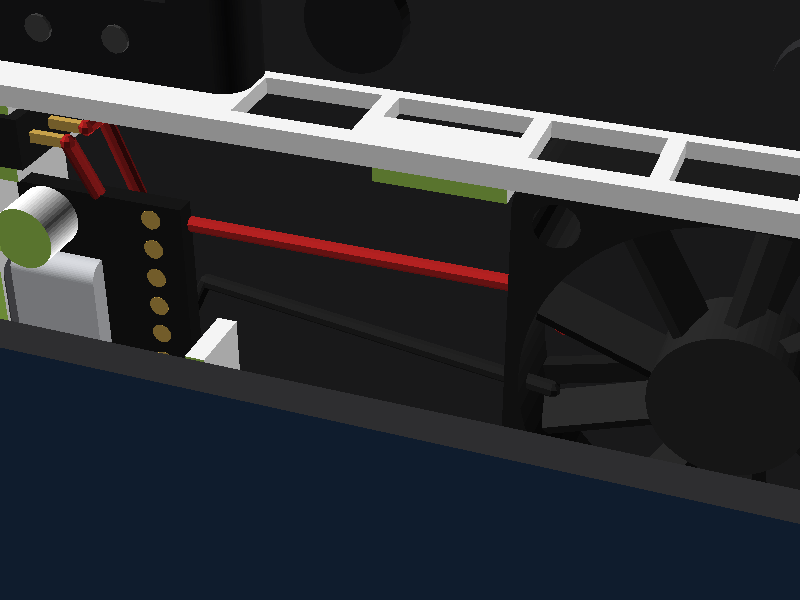
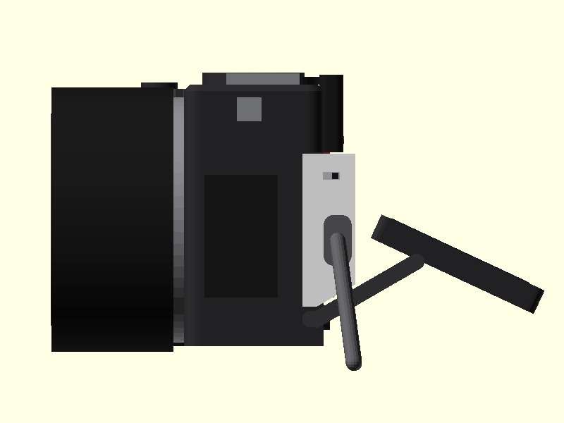
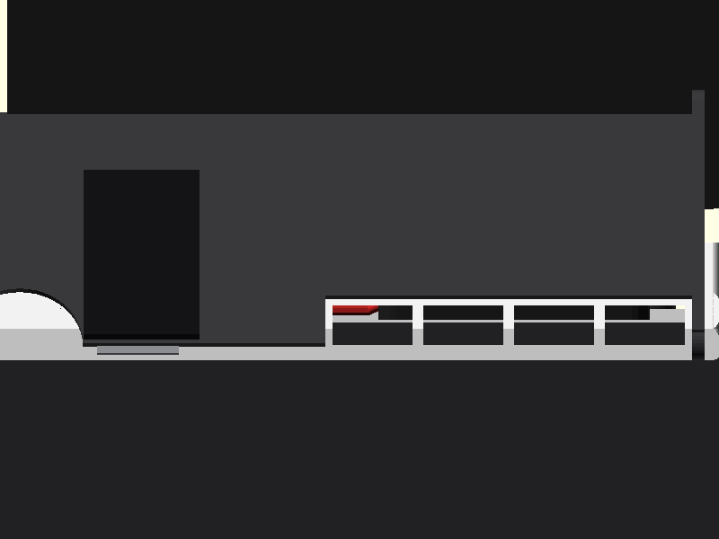
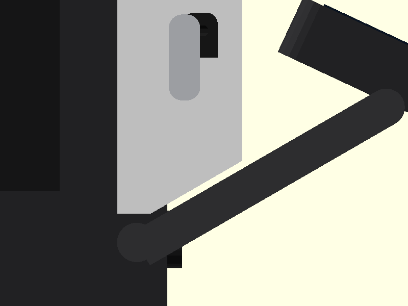

# Sony a6300 rear cooling fan (DRAFT)

A small box that sits in the screen recess on the camera's back, under the eyepiece, with the screen
tilted out, and blows air onto the magnesium back plate for long 4K takes. It runs from USB-C on the
cable side at full 5 V with an Off / On mini slide switch right above the port. A second part, a tool-free shoe arm,
slides into the flash shoe after the box is seated and locks it in place with zero screws or inserts.
The box size comes from a cardboard test on the real camera; the shoe and button positions from caliper
readings and photos (±2 mm). Three fit-test shells have been tried on the camera; the third, with the current
bottom, sits well, and the first shoe arm came out `3 mm` too long and has been shortened
([dev/FIT-TEST.md](dev/FIT-TEST.md), which also holds the numbered measurements `M1..M14` that the models use);
the box itself is **not printed yet.**

The camera's dual-hinge screen linkage, its tilt bracket (plate, flanges, cut-back window; fit test 2), and the `2026-11-19` top ruler positions are modelled and checked in the scene. The box's bottom runs parallel to that bracket, `≈ 1 mm` above it, and the exhaust outlets avoid the eyecup, the fan housing and the bracket: `424 mm²` of free-air exhaust with `arm_mount = true` (right `158` + top `110` + bottom `156` through the bracket's window), `448 mm²` standalone, vs `503 mm²` fan free area. Option #1 from [dev/MOUNTING-NOTES.md](dev/MOUNTING-NOTES.md) (tool-free pin-and-socket slide-on shoe arm, with micro-suction + screen clamp as a zero-hardware fallback) is implemented.

| On the camera | Inside (front cut away) | Side | Arm and shoe |
|---|---|---|---|
|  |  |  |  |

| From below: the bottom slots in the bracket's window | Bottom parallel to the tilt bracket |
|---|---|
|  |  |

| File | What |
|---|---|
| [sony-a6300-fan.scad](sony-a6300-fan.scad) | The printable box ([preview](sony-a6300-fan.png)). Parameters at the top |
| [sony-a6300-fan-arm.scad](sony-a6300-fan-arm.scad) | Second printable part: tool-free pin-and-socket slide-on shoe arm ([preview](sony-a6300-fan-arm.png)). Locating lug engages the box's front pocket on `-Y` slide-in (zero screws/inserts). `top_mount = "shoe"`, `"quarter"` or `"none"` |
| [dev/sony-a6300-fan-fit-test.scad](dev/sony-a6300-fan-fit-test.scad) | Fit Test 4 thin shell with the box's outside shape (flat heel + `30°` bottom bevel, rounded leading end + top-back latch hook channel), real arm pocket + fused top bearing boss, staggered side depth marks (`1`, `2`, `3`, `4`, `5.3 mm` recess edge, `8`/`10 mm` ticks), built-in `5`/`10 mm` X-rulers (top-front & bottom-back) + left `+2`/`+4 mm` Z-ticks, front V-grooves (`14.5 mm` band, fan grille + 4 screw holes), and 45°-beveled blind fake cutouts for all exhaust slots, the left-wall Off/On switch slot, and the stepped USB-C port |
| [dev/sony-a6300-fan-scene.scad](dev/sony-a6300-fan-scene.scad) | Display only: the box and arm on the camera with the fan, switch, USB-C board, wires and cable. `-D cutaway=true` |
| [dev/a6300-camera.scad](dev/a6300-camera.scad) | Display model of the a6300 from Sony's dimensions plus calipers, `2026-11-19` ruler photos (top controls/eyecup), and the dual-hinge LCD linkage with its tilt bracket from the fit test 2 photos (`M1..M11`: `60°` arm stop, ±0.5 mm), and the top deck that carries the hot shoe at `64.0 mm` (`M13`, fit test 3) |
| [dev/MOUNTING-NOTES.md](dev/MOUNTING-NOTES.md) | Five brainstormed tool-free mounting options, physical constraints, and 3-criterion ranking |
| [dev/FIT-TEST.md](dev/FIT-TEST.md) | Fit test reports #1 (2026-11-19), #2 and #3 (2026-11-20), the numbered measurements `M1..M14` with the parameter each one feeds, and the Fit Test 4 sheet |

## Parts

| Part | Exact item | Size used in the model | Notes |
|---|---|---|---|
| Fan | **WINSINN 3007 5V, hydraulic bearing**, XH2.54 plug, 300 mm leads (Amazon) | 30 × 30 × 7, holes on 24 × 24, M3 self-tapping | 8500 rpm. Hydraulic bearings are quieter than ball bearings and fine with the axis horizontal. WINSINN publishes no airflow or noise figure. The Sofasco table below suggests ~28 dBA at full 5 V speed — full speed maximizes airflow for this tiny fan |
| Fan, ball-bearing alternative | GDSTIME 3007 5V dual ball (Amazon) | 30 × 30 × 7 | 9000 rpm, 4.1 CFM, "25 dBA ±10 %", 0.15 A. Longest life, but more bearing tick and hum |
| Fan, best (if you find it) | Sunon MF30060V2-1000U-A99 | 30 × 30 × 6.5, fits the same box | 3.7 CFM at 15.7 dB(A). Distributors only (DigiKey, Mouser), often out of stock |
| USB-C | **Adafruit 4090**, "USB Type C Breakout Board – Downstream Connection" | PCB 20.32 × 13.97 × 1.6, connector centred on the long edge, 2 × Ø2.5 holes 15.24 apart, 2.54 in from the connector edge | Numbers from Adafruit's Eagle board file. 5.1 kΩ on CC1 and CC2 (R1, R2), so C-to-C chargers give 5 V. Solder the wires to VBUS/GND, no header |
| Switch | **SS12D00G4 mini slide switch, 1P2T** (2 positions, Off / On, 4 mm knob) | Body 8.5 × 4.0 × 3.8, knob 4 mm, 2 mm travel | Sits in a printed cradle on the inside of the left wall directly above the USB-C board, sliding front-to-back along `Y` (Off toward camera, On toward operator); knob pokes ~2.4 mm out |
| Fixing | 2 printed pins through the board holes (heat-staked), or M2.5 screws into the posts | | |

## Bill of materials

Prices are rough Amazon / Adafruit figures in USD. Check the listings.

| Qty | Item | Exact part / spec | Approx. |
|---|---|---|---|
| 1 | Fan | WINSINN 3007 5V **hydraulic**, XH2.54 plug, 300 mm leads (usually a 2-pack, so one spare) | $10 / 2 |
| 1 | USB-C socket board | Adafruit 4090 USB Type C Breakout – Downstream Connection | $3 |
| 1 | Switch | SS12D00G4 mini slide switch, 1P2T, 4 mm knob | $5 / 20 |
| 4 | Fan screws | M3 × 8 self-tapping (front face 1.6 + fan frame 7) | from a kit |
| 1 | Top insert (optional) | 1/4"-20 heat-set insert, for `top_mount = "quarter"` and a metal cold-shoe adapter | $8 / 10 |
| 2 | Board screws (optional) | M2.5 × 6, if you don't heat-stake the printed pins | from a kit |
| ~30 cm | Wire | 26 AWG silicone, red + black | $8 / spool set |
| a few | Heat-shrink | 2–3 mm | from a kit |
| 2 | Pads | thin self-adhesive felt or tape, `0.3–0.5 mm` thick, about `10 × 5 mm`, on the bottom bevel where it faces the tilt bracket | $5 / sheet |
| ~15 g | Filament | PETG or ASA | – |
| 1 | Cable | USB-C to USB-C, **right-angle** plug (keeps the cable tight to the side) | $10 |
| 1 | Power | Any USB-C charger or power bank (5 V, 0.2 A is plenty) | have |

Tools: soldering iron, calipers, M3 tap or screwdriver.

## The box

    front (operator side)
      ┌──────┬──────────┬──────────┬───┐
      │      │      [ ] │          │   │   arm socket in top band; 6 mm right exhaust duct
  ▭─▭─┤ bay  │ chamber  │  ( fan ) │   │   USB-C + Off/On slide switch out of left wall; fan blows onto plate
      └──────┴──────────┴──────────┴───┘   bottom: flat 3.5 mm heel at the plate, then a 30° bevel up to 5.5 mm at the front
    solid back rim inside the 5.2 mm recess; 3 right + 6 top windows + 4 bottom-back slots in the tilt bracket's window

**80 × 37.5 × 13 mm**, free-air exhaust `424 mm²` (right `158` + top `110` + bottom `156`; `448 mm²` with `arm_mount = false`: top `135`) vs `503 mm²` fan free area.

- **Size, from cardboard & fit tests 1 and 2 on the camera:** the initial shell (`35 mm` at the plate, `32 mm` at the front) left ~4 mm unused at the back above the hinge pivot ear, so the back went to `37.5 mm`; the `32.0 mm` front height has fit twice with `≈ 1 mm` to spare.
- **Bottom, parallel to the tilt bracket ([fit test 2](dev/FIT-TEST.md), `M1..M4`, `M12`):** with the screen pulled out, the bracket's plate sits right under the box at `30°`, so there is little room to grow into: a wedge of `≈ 1 mm` at the front and `≈ 2.3 mm` at mid-depth under the old `22.2°` bevel, and the hinge knuckles `≈ 1 mm` under the back edge. The bottom now follows it: a flat heel from the plate to `Y = 3.47` (over the knuckles), then `slant_a = 30°` up to `slant_rise = 5.5` at the front, turned about the same front-bottom corner. That is up to `1.4 mm` lower than before. Fit test 3 confirmed it: the bevel runs parallel to the bracket, `≈ 0.3–0.5 mm` above it (`M14`; `0.8 mm` in the model). Stick two pads of that thickness (thin felt or tape) on the bevel (`Y ≈ 7.5..12.5`, near `X ≈ 15` and `X ≈ 65`) and the box rests on the bracket on purpose, damped, instead of nearly touching it at one corner. The inside floor follows the bottom, `1.2 mm` thick.
  The top wall is 1.2 mm so the fan sits as high as possible. The screen leaves about 14 mm of depth, so the box is 13.0 (1.6 front + 7 fan + 4.4 gap). The
  recess is about 88 mm wide and open on the left; the box is 80, placed 4 mm from the camera's left edge.
- **Layout:** the electronics bay is on the left (cable side) with a lower divider (`Y >= 5.2`, `0.17 mm` behind the USB-C PCB)
  stopping at the USB-C centre (`usb_zc`) so the upper bay stays open for wiring; the `SS12D00G4` Off/On switch sits right above the PCB on the left wall; the fan sits at
  `X = 42.1..72.1` leaving a 6 mm exhaust duct along the right wall; the open chamber between bay and fan makes the air sweep the plate.
  The intake grille uses an open 4-spoke diagonal X-guard (`45°/135°/225°/315°`, `1.2 mm` spokes, no mid-radius ring), giving `~522 mm²`
  open intake area (`> fan free area 503 mm²`, `+10%` over the old mid-ring grille), keeping the uncovered top arc wide open, and
  staying coprime with the 9-blade impeller (`gcd(4, 9) = 1`) to avoid in-phase blade-pass whine near a mic.
- **Noise vs. cooling:** Sofasco's datasheet for its 3007 family (same size, sleeve bearing) lists
  12000 rpm 35 dBA, 10000 rpm 31, 8000 rpm 26, 6000 rpm 22 (1.6 CFM). The bearing type adds tick or hum on top of that,
  so a hydraulic-bearing fan gives the quietest result while running at **full 5 V** to maximize airflow.
  Mount the fan with the label side (the outlet) toward the camera.
- **Airflow & microphones:** blowing onto the plate cools better than sucking air off it. With the LCD tilted up, the screen sits right in front of the box and its solid tilt arm covers most of the recess bottom, so the right and top exhaust windows sit outside the `5.2 mm` recess (`Y = 5.6..11.4`), and the bottom slots sit in the one part of the bottom the tilt arm leaves open:
  - **Right (`+X`, `158 mm²`):** 3 × 9.08 mm wide slots (`Z = 6.1..35.7`, `1.2 mm` ribs) fed directly by the `6 mm` right exhaust duct; unobstructed out into open air.
  - **Top (`+Z`, `110 mm²` with `arm_mount = true`, `135 mm²` standalone):** 6 slots (`Y = 5.6..11.35`, `3.15 mm` behind the arm boss) that stay **solid** over the `24 mm` EVF eyecup / USB-C bay (`X < 22.5`):
    - `top_l` (`X = 22.5..31.15`, `8.65 × 5.75 mm` = `50 mm²`): sits cleanly right of the `24 mm` eyecup over the open mid plenum;
    - `top_m` (`X = 32.35..41.8`, `9.45 × 3.15 mm` = `30 mm²`, or `5.75 mm` = `54 mm²` standalone): vents the mid plenum cleanly behind the fused top boss & thickened arm (`Y = 5.6..8.75`, `0.25 mm` behind the arm's `-Y` face);
    - `4 × 7.70 mm` uniform right-half slots (`X = 43.0..77.4`, `1.2 mm` ribs): the left portion (`X = 43.0..72.1`) sits `0.3 mm` above the solid 3007 fan housing (excluded from the `110 mm²` unblocked count), while the rightmost slot clears the `6 mm` right duct (`X = 72.1..77.4`, `5.30 × 5.75 mm` = `30 mm²`, no rib inside the duct; keep a windscreen/deadcat on a cold-shoe mic if used).
  - **Bottom (`-Z`, `156 mm²`):** 4 × 8.85 mm slots (`Y = 1.6..6.0`, `X = 37.0..76.0`) fitted to the cut-back window in the tilt bracket's plate (`bot_win`: `X = 36.2..76.8`, open to `Y = 6.7`; fit test 2, `M7`, `M8`), `0.8 mm` inside it at each end so neither the step nor the right flange covers them. Seen from below they are in plain view ([dev/scene-bottom.png](dev/scene-bottom.png)), so they count as free-air exhaust. A continuous `1.6 mm` rail along `Y = 0..1.6` frames them so no free-ended ribs can snag or snap when sliding past the screen linkage. The rest of the bottom (`X = 0..37`) stays solid: the bracket's plate covers it down to the pivot line (`M10`).
- **Slide-in and latch hook channel ([fit test 1](dev/FIT-TEST.md), photo 1):** the recess is open at the left, so the box slides in from the cable side and its **right end goes in first**. That end must ride over the raised hinge bracket's screws, so its leading edges are rounded:
  - `lead_r = 1.2` on its top and bevelled bottom edges (preserves full `1.2 mm` wall thickness and stays clear of the right exhaust slots);
  - `lead_r_back = 0.8` on the vertical back edge against the plate (`0.5` on the `1.2 mm` fit-test shell).

  The screen's latch pin hangs from the middle of the recess top edge (`~1 mm` from the plate, `~2–3 mm` thick, `X_box ≈ 40`). Instead of snapping over it (which stresses the tab and fights the shoe arm's `X` alignment), an open top-back hook channel (`latch_cut_x0 = 34`, `latch_y1 = 4.1`, `latch_drop = 2.0`, over the empty `air_gap` behind the fan) lets the right half glide straight underneath the pin with zero sideways contact, while the `Y = 4.1` top rim hooks the pin's front face against `+Y` tip-out. Prints support-free.
- **USB-C:** the board stands parallel to the front face on two posts from the front wall. Outside, the left wall is
  counterbored down to 0.6 mm around the opening so the plug's overmold sits in it and the plug reaches full depth.
- **Switch:** in the left (`-X`) wall directly above the USB-C board (`sw_yc = 7.05`, `sw_zc = 32.0`, `5.5 mm` below the box top, `+2.3 mm` above the USB-C PCB and posts), sliding front-to-back along `Y` (`Off` toward the camera, `On` toward the operator; `+8.4 mm` above the `65°` LCD / `+12.9 mm` at `90°`, `~2.4 mm` knob protrusion). Because the left end of the recess is open (Fit Test 1), the switch sits in full view and clears the eyecup completely.
- **Eye sensor:** it sits on the eyepiece, right above the box. Set *FINDER/MONITOR → Monitor (manual)*.
- **Mounting: tool-free pin-and-socket slide-on shoe arm** ([sony-a6300-fan-arm.scad](sony-a6300-fan-arm.scad), [close-up](dev/scene-mount.png), [dev/MOUNTING-NOTES.md](dev/MOUNTING-NOTES.md)).
  After sliding the box into the screen recess, slide the arm `-Y` into the camera's flash shoe:
  - Its ISO 518 foot (`18.4 × 16 × 1.9 mm` footprint, 45° rear taper leaving `~10.1 mm` full-width rail / `13.25 mm` total lip/floor engagement) has `0.8 mm` 45° front-entry corner chamfers and two `0.2 mm` tapered underside friction ribs engaging the shoe floor spring;
  - A `10 × 4 mm` drop-tab clears the box inside the top `14.5 mm` screen-free band (`14.65 mm` clear of the flash button, `2.9 mm` above the 65° LCD / `7.4 mm` at 90°), thickening right above the box top (`Z >= 38.3`, `+0.8 mm` clear) to **`8.2 mm`** (`Y = 9.0..17.2`, `2.3 mm` clear of the diopter wheel) with a `3.0 mm` 45° corner gusset into the bridge (`0.8 mm` behind the camera body);
  - At the box top band, the tab carries a `6.0 × 6.0 × 4.2 mm` locating lug with a **flat horizontal load-bearing top shelf** (`3.4 mm` flat bearing inside the socket + `0.6 mm` top/side tip lead-in chamfers) and a **45° bottom ramp**;
  - During the final ~4 mm of shoe travel, the lug enters a `6.5 × 7.3 mm` front-plate pocket (`0.8 mm` spare under the lug, so an arm that hangs slightly low still seats) backed by a **monolithic fused top bearing boss** (`2.6 mm` deep behind the `1.6 mm` plate = `4.2 mm` total bearing depth, `0.8 mm` past the flat lug shelf and `0.2 mm` past the lug tip, fused `2.55 mm` solid up into the `1.2 mm` top wall for a `3.75 mm` solid roof with no side or bottom internal collar walls), taking gravity in pure vertical shear (zero backward wedging force) and locking all 6 DOF with zero screws or inserts (the same box also works standalone with micro-suction pads + tilted screen clamp as a zero-hardware fallback).
  - A printed cold shoe on top keeps the shoe usable for a light mic; `top_mount = "quarter"` gives a 1/4"-20 insert for a metal shoe adapter.
- **Material:** PETG or ASA, not PLA.

## Printing

Both STLs are exported in print orientation (`orient` / `arm_orient = "print"`; `"display"` shows them as fitted).
Both are manifold and print **without supports** (checked with `tools/stl-check.py`).

| Part | On the bed | Watch |
|---|---|---|
| Box | Front face (grille) down, open back up | Short horizontal bridges only: 7.7–9.5 mm over the exhaust windows (`9.1 mm` right, `8.7` / `9.5` / `7.7 mm` top, `8.9 mm` across the 4 bottom-back slots along the `1.6 mm` connecting back rail), 6–8 mm over the USB-C opening, `4.2 mm` over the left switch cradle back stop and `2.0 mm` over the switch knob slot. The fused top bearing boss, posts, switch cradle, lower bay divider and open `Y = 4.1` latch hook step grow straight up from the front plate and walls with zero overhangs; the `30°` bottom bevel leans `30°` off vertical on the bed |
| Arm | Lying flat on its back (`+Y` tab/bridge/top-block face down, `-Y` up) | Zero faces flatter than 45° (`tools/stl-check.py`): continuous XY perimeters wrap the bridge-to-tab corner for bending strength, the flat-top / 45°-bottom-ramped lug grows straight up support-free off the tab, and the 45° rear foot taper eliminates the old `3.2 mm` foot flange overhangs and `18.8 mm` cold-shoe ceiling bridge (only a small front-stop bridge remains on the top cold shoe) |

PETG or ASA, 0.2 mm layers, 3 perimeters. Print the fit-test shell and the arm first: check the shell on the camera and the foot in the shoe.

## Wiring

    USB-C VBUS ── switch common
                  switch On ── fan red (+)   (full 5 V)
    USB-C GND  ─────────────── fan black (−)
    CC1, CC2   ── 5.1 kΩ ── GND   (already on the Adafruit board)

## Facts gathered

| Item | Value | Source |
|---|---|---|
| a6300 body (W×H×D) | 120.0 × 66.9 × 48.8 mm (grip to monitor), 404 g | Sony spec / apotelyt |
| LCD | 3.0" 16:9, tilts ~90° up, ~45° down | apotelyt |
| Sony 4K limit | ~29 min at 20–30 °C, ~20 min at 40 °C, with *Auto Pwr OFF Temp = High* | Sony help guide ILCE-6300 |
| What helps (reported) | LCD pulled away from body, metal cage + thermal pads, external power | DPReview, 4kshooters, diyphotography |
| 30-min cap | Removed by OpenMemories: Tweak (PMCA app, at your own risk) | github ma1co/OpenMemories-Tweak |
| USB power | Micro-USB runs the camera with a battery inside, but Sony warns it adds heat. An NP-FW50 dummy battery on 5 V/2–3 A moves the battery heat outside | Sony help guide, dummy-battery listings |

## Copper (idea, later)

The fan comes first. Afterwards, small stick-on finned heatsinks (≤ 3 mm tall with a 4 mm gap) or flat copper
on **thermal tape** under the fan may add a little. Plain double-sided tape insulates.

## Measured so far (2026-11-18, calipers + photos)

| What | Value | Model before |
|---|---|---|
| Clear height on the back: eyepiece underside → tilted screen's top edge (photo angle) | 38.46 | box 38.0 |
| Eyepiece underside above the base (from photo scale, ±1.5) | ~47.5 | 44 |
| Of that, fully free depth from the eyepiece down | 17.47; below it the tilted screen's top gets in the way | – |
| Eyepiece protrusion from the magnesium back plate | 9.92 | 19 |
| Screen's top edge behind the back plate (photo 7 angle) | 22.61 | 6 |
| Screen recess depth (screen flipped out) | 5.19–5.51 | none |
| Screen thickness (closed: outer face → plate); sits ~1–1.5 proud of the frame, body not perfectly flat | 6.3–6.4 | 7 |
| Shoe: open end → back edge, over a small hump | 5.88 | 4 |
| Cardboard test block that fits: height against the plate / outside face (bottom bevelled straight from the plate) | 35 / 32.5–33 | box 38, small front slant |
| Depth the screen allows: block ~11 + 3 mm extra piece (30 tall) before it touches the screen | ~14 | 12.6 → 13.0 |
| Top band under the eyepiece where the screen never reaches, at any depth | 14.5–15 | – |
| Recess right edge from the eyepiece-side end (photo, ruler) | ~87 | 77 |
| Shoe centre from the eyepiece-side end (from photo scale, ±1.5) | ~41 | 52 |
| Dual-hinge LCD linkage (side photos + fit tests 1 and 2) | lower arm ~29.5 mm, mechanical stop `60°` from vertical (`30°` above horiz; `57–58°` in fit test 1), max LCD tilt ~66–68° (photo 4), upper pivot ~12 mm below LCD top | ~54° stop |
| Top strip controls & eyecup (`2026-11-19` ruler photo) | eyecup `~24 mm` (`X_cam ≈ 2.5..26.5`), diopter `~33.5`, flash `~63.5`, MENU `~76.2`, recess right `~88` | eyecup `3..30`, diopter `35.5`, flash `62`, MENU `73`, recess `87` |
| Top deck that carries the hot shoe (fit test 3, `M13`) | `≈ 63.8 mm` above the base: the first shoe arm hung `2.8–3.4 mm` lower against the shell than modelled. The model uses `64.0`, and the arm's drop is `36.4 mm` | `66.9` (Sony's overall height, which includes the dials); drop `39.3` |
| Tilt bracket under the box (fit test 2 photos, `2026-11-20`; full table in [dev/FIT-TEST.md](dev/FIT-TEST.md)) | pivot `2.0` behind the plate and `3.2` below the box's back-bottom corner; plate `30°` above horizontal, `≈ 1 mm` under the front-bottom corner; cut-back window `X_box = 36.2..76.8`, open to `Y = 6.7`; plate solid for `X_box ≈ 9.5..36.2`; no frame lip under the screen | pivot `2.2` lower, solid `64 mm` arm, cut-back from `36.7` |
| Screen latch pin & open left recess (fit test 1) | left end of recess open (no 5.2 mm left wall); latch pin `~5 mm` wide at `X_box ≈ 40` (`~1.5–2.5 mm` right of shoe center), `~1 mm` from plate, `~2–3 mm` thick, `~1.2 mm` hang | closed left recess (`X = 3`), unmodelled pin |

## Open / unproven

- **Fit test follow-ups ([dev/FIT-TEST.md](dev/FIT-TEST.md)):**
  - Confirmed on camera: photo 4 is max tilt (no screen collision); photo 2's "+2 mm shoe offset" was parallax (photo 8 shows shoe `~1 mm` left of pocket); bracket cut-back starts at `X_box ≈ 36.7`.
  - Still to verify with the printed shoe arm ([sony-a6300-fan-arm.scad](sony-a6300-fan-arm.scad)): lug-to-pocket alignment in **X and Z**, shoe-spring friction hold (`foot_rib_h = 0.2 mm`), and whether the arm alone prevents `-X` slide-out from the open left recess.
  - Confirmed on Fit Test 2: the `37.5 mm` back and `32.0 mm` front heights fit, and the bottom slots sit in the bracket's cut-back window.
  - Confirmed on Fit Test 3: the `30°` bottom is parallel to the bracket and the shell seats (`M14`).
  - Failed on Fit Test 3: the shoe arm was `≈ 3 mm` too long and did not seat (`M13`). It is `2.9 mm` shorter now and the pocket has `0.8 mm` more room below the lug; both come from photo readings (`± 0.4 mm`), so the arm needs one more test print.
  - Open: whether the shoe arm is needed at all. The empty shell sits well without it and an indentation in the body limits the sideways slide somewhat; the wired box, with a USB-C cable pulling it toward the open left end, has not been tried (`arm_mount = false` is the arm-less box).
  - Still to verify on Fit Test 4 ([dev/FIT-TEST.md](dev/FIT-TEST.md#fit-test-4-measurement-sheet)): the arm seats fully and the lug sits in the pocket without binding, thin pads on the bevel still let the screen reach its stop, and the bottom slot marks sit in the bracket's window seen from below. Carried over: `Y = 0..4.1` latch hook channel clearing the pin without contact and damping `+Y` wobble, and finger reach to the left-wall Off/On switch above USB-C.
- **Tilted screen clearances & partial intake:** Modelled dual-hinge clearances at `lcd_tilt = 65°` (`arm = 60°`): `front = +3.7 mm` (`+2.5 mm` at `90°`), `bevel = +0.8 mm` along its whole length, `heel_above_knuckle = +0.95 mm`, `switch_above_lcd = +8.4 mm` (`+12.9 mm` at `90°`), `tab_above_lcd = +2.9 mm` (`+7.4 mm` at `90°`). `12.4 mm` of the `28 mm` grille sits completely above `lcd_tf` (`18.2 mm` above `lcd_tb`; `16.9 mm` / `23.3 mm` at `90°`); the lower half draws through the side wedge behind the screen, reducing airflow below the fan rating by an unknown amount.
- **Airflow, recirculation & noise (untested on hardware):** Thermal effectiveness of blowing into the `4.4 mm` plate gap, warm-air recirculation behind the tilted screen, cold-shoe mic wind noise over the top vents, and actual WINSINN 3007 hydraulic noise at full 5 V.

## Steps

1. Print the shortened shoe arm ([sony-a6300-fan-arm.scad](sony-a6300-fan-arm.scad)) and try it on the Fit Test 3 shell; print the Fit Test 4 shell ([dev/sony-a6300-fan-fit-test.scad](dev/sony-a6300-fan-fit-test.scad), ~15 min) only if the lug needs the extra `0.8 mm` under it. Fill in the [Fit Test 4 measurement sheet](dev/FIT-TEST.md#fit-test-4-measurement-sheet): arm seats fully, lug height and X fit, shoe friction & `-X` hold, thin pads on the bevel, bottom slot marks in the window, latch pin, switch reach / USB-C exit.
2. Check that the screen still tilts up far enough to see from above without crossing the `14.5 mm` scribe line.
3. Order the parts above, plus a short right-angle C-to-C cable (no M3 arm screws or inserts needed).
4. Print the box, wire it, fit it.
5. Test with 4K, Auto Pwr OFF Temp = High, the 30-min cap removed, and a dummy battery. Log the time to the
   overheat warning with and without the fan, at the same room temperature.
