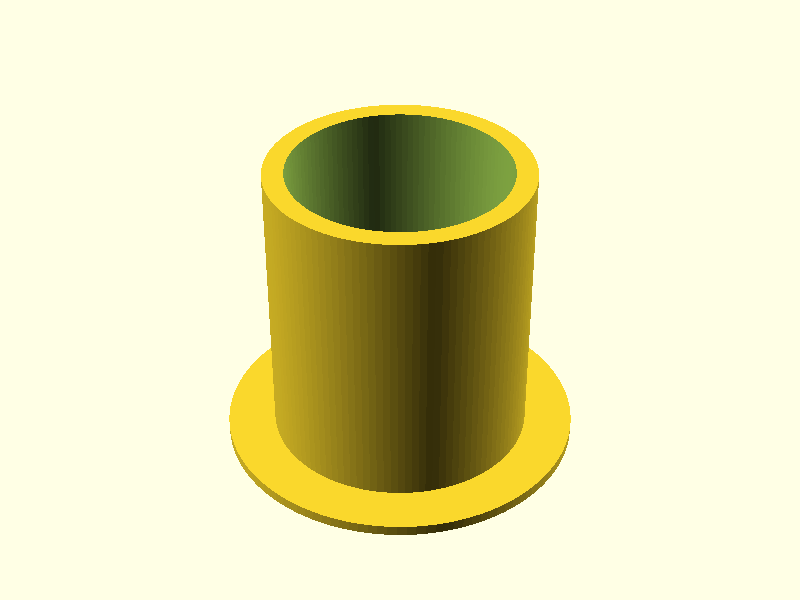

# spacer-insert

Short tube insert: 7.5 mm outside diameter, 8.6 mm tall, with a 10.25 mm lip that sticks out 0.3 mm at the top. Dimensions are parameters at the top of [spacer-insert.scad](spacer-insert.scad).
