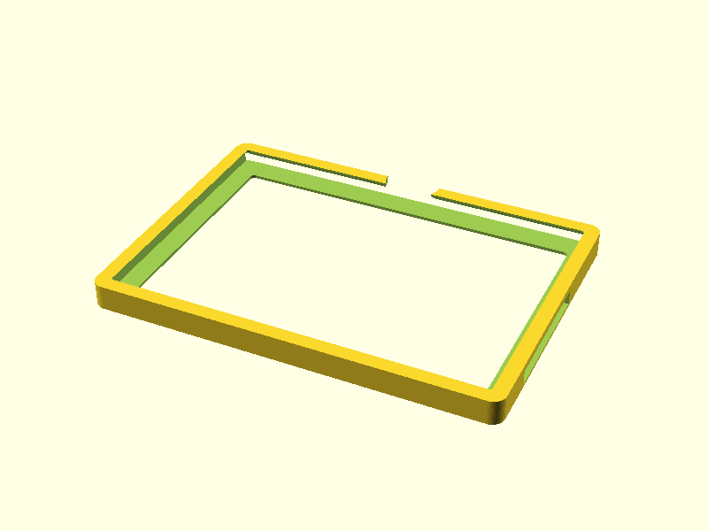

# Surface Go window frame

Slide-in frame for a 1st-gen Surface Go (245 x 175 x 8.3 mm) used as a shop-window display. The flat front face is taped to the inside of the glass all the way round, screen facing out. The tablet slides in from the open top edge and rests on the bottom wall; four thumbscrews in the back press it against the front lip so it doesn't rattle. The charger plugs in through a slot.

| Part | File | Notes |
|---|---|---|
| Landscape frame | [surface-go-window-frame.stl](surface-go-window-frame.stl) | opens on the long top edge, charger slot on the right |
| Portrait frame | [surface-go-window-frame-portrait.stl](surface-go-window-frame-portrait.stl) | opens on the short top edge, charger slot at the bottom |

Each frame is 253 x 183 mm (28 mm deep at the screw ears), so it fits a 256 mm bed (Bambu P1/X1/A1) in one piece. The tape is permanent, so print the frame for the orientation you want; a second frame is needed to switch.

## Print

- Front face down on the bed: that's the face that gets taped, so it comes out flat and clean.
- No supports. The back lip overhangs 2.5 mm flat, then slopes at 45 degrees.
- Matte black PETG, or ASA on an enclosed printer. Avoid PLA in a sunny window.
- The fit is deliberately loose (1 mm each side, 1.5 mm front to back), so it fits without a test print.

## Mount

1. Clean the glass with isopropyl alcohol.
2. Run 12 mm VHB tape (e.g. 3M 5952, black) round the front face. The flat strip is 16 mm wide, all four sides.
3. Use a level, press the frame onto the glass hard for 30 s, and wait 24 h before loading the tablet.
4. Slide the tablet in from the top, screen towards the glass, and plug in the charger through the slot.
5. Put a small felt pad on the tablet's back under each screw, then turn the four M4 x 20 thumbscrews in finger tight until the tablet stops rattling.

## Hardware

- 4x M4 x 20 thumbscrews (knurled head). They cut their own thread in the 3.4 mm holes the first time; for PLA set `screw_hole = 3.3`, for M4 heat-set inserts `5.6`.
- 4x small felt pads (about 10 mm).
- 12 mm VHB tape, about 0.9 m.

## Check before printing

All dimensions are parameters at the top of [surface-go-window-frame.scad](surface-go-window-frame.scad); the portrait file reuses them.

- `cable_y`: Surface Connect slot position (an estimate). Measure your tablet.
- `btn_x`: power/volume buttons, only cut in the portrait frame (in landscape they are at the open top).
- `clear`, `play_t`: side and front-back clearance.
- `screw_x`, `screw_hole`: thumbscrew positions and hole size.
- `tab_r`: keep at or below the tablet's corner radius.
